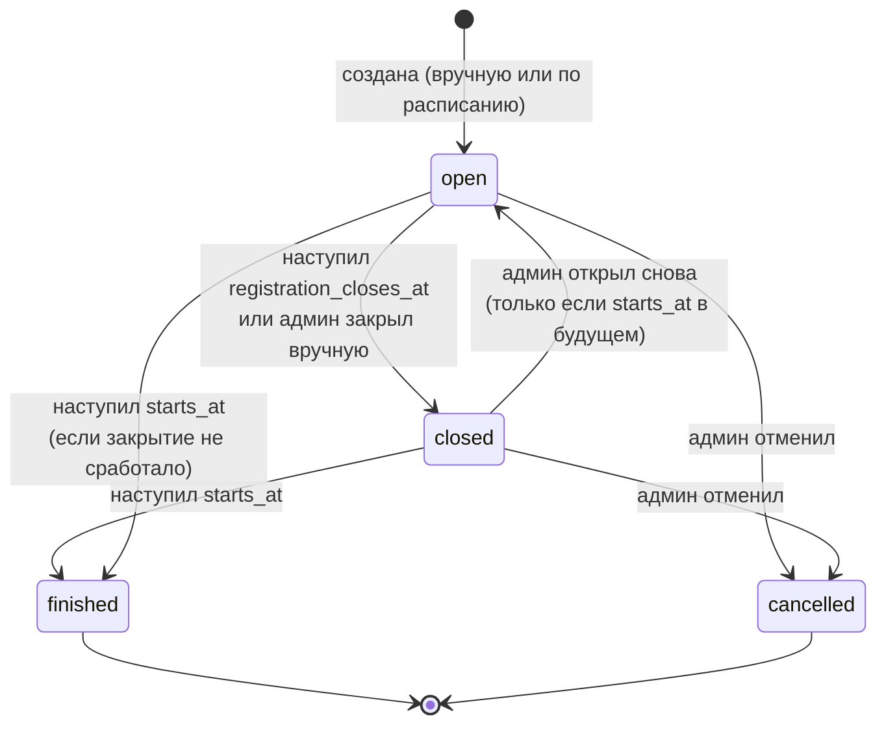
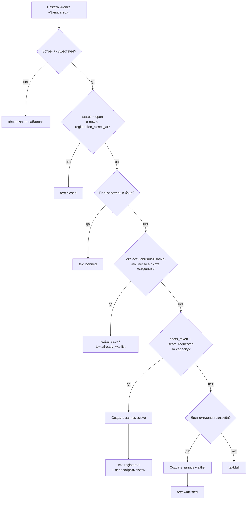
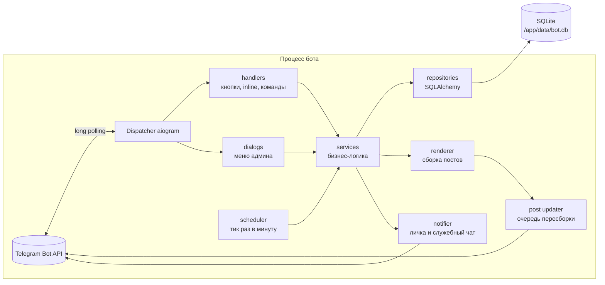
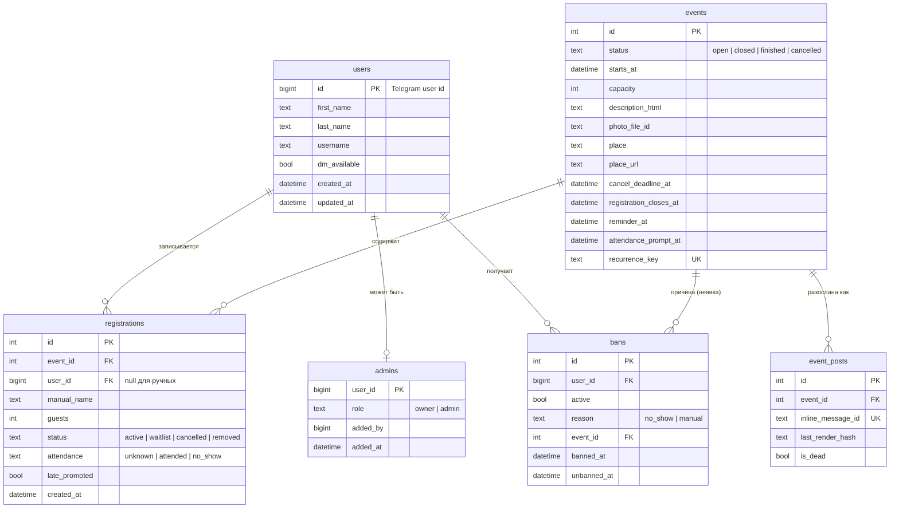
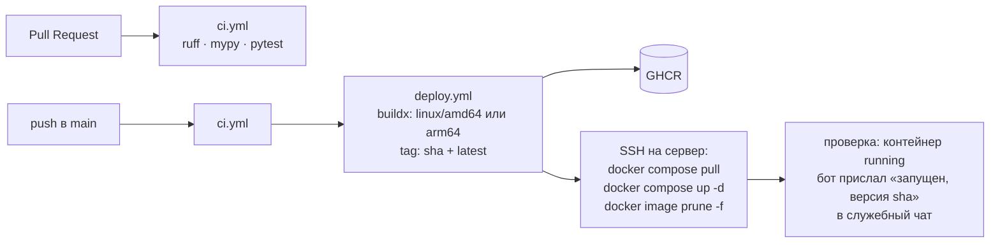
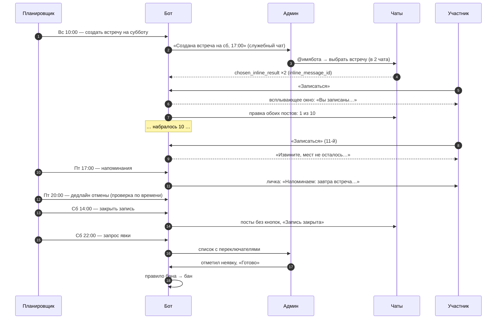

# meetup-rsvp-bot — описание проекта

> Telegram-бот для записи на субботние встречи с ограниченным числом мест, поимённым учётом и баном за неявку.

| | |
|---|---|
| **Версия документа** | 0.1 (черновик) |
| **Дата** | 23 октября 2026 |
| **Статус** | Бизнес-логика ждёт подтверждения админа (см. раздел 19 «Открытые вопросы») |
| **Рабочее название** | `meetup-rsvp-bot`, Python-пакет `meetup_bot`. Можно заменить |
| **Аудитория** | Разработчики проекта |

---

## Содержание

1. [Цель и контекст](#1-цель-и-контекст)
2. [Глоссарий](#2-глоссарий)
3. [Роли и права](#3-роли-и-права)
4. [Пользовательские сценарии](#4-пользовательские-сценарии)
5. [Бизнес-логика](#5-бизнес-логика)
6. [Тексты сообщений](#6-тексты-сообщений)
7. [Настройки](#7-настройки)
8. [Особенности Telegram Bot API](#8-особенности-telegram-bot-api)
9. [Архитектура](#9-архитектура)
10. [Модель данных](#10-модель-данных)
11. [Планировщик](#11-планировщик)
12. [Интерфейс админа](#12-интерфейс-админа)
13. [Стек и версии](#13-стек-и-версии)
14. [Структура репозитория](#14-структура-репозитория)
15. [Конфигурация и локальная разработка](#15-конфигурация-и-локальная-разработка)
16. [Тестирование и качество кода](#16-тестирование-и-качество-кода)
17. [Деплой и эксплуатация](#17-деплой-и-эксплуатация)
18. [План работ](#18-план-работ)
19. [Открытые вопросы](#19-открытые-вопросы)
20. [Бэклог (после MVP)](#20-бэклог-после-mvp)
21. [Приложения](#21-приложения)

---

## 1. Цель и контекст

Русскоязычное сообщество в Монтевидео проводит встречи по субботам. На встречу помещается ограниченное число людей, по умолчанию **10**. Сейчас запись идёт вручную в закрытых Telegram-чатах. Это неудобно: непонятно, кто записался, люди записываются и не приходят.

**Что должен делать бот:**

1. Админ рассылает в один или несколько чатов пост о встрече с кнопкой «Записаться».
2. Люди записываются нажатием кнопки, пока не набрано 10 человек. Дальше бот отвечает «мест не осталось, попробуйте в следующую субботу».
3. Запись поимённая. После встречи админ отмечает, кто не пришёл, и эти люди навсегда теряют возможность записываться (пока админ их не разбанит).
4. Всё, что может понадобиться менять (число мест, время, тексты, правила), меняется через Telegram, без правки кода.

**Нефункциональные требования:**

- Хостинг бесплатный или почти бесплатный, работа 24/7, без привязки к чьему-то компьютеру.
- Над кодом работают несколько разработчиков из разных стран.
- Админы управляют ботом из любой точки, только через Telegram.
- Нагрузка минимальная: десятки пользователей, пики в несколько нажатий в секунду сразу после публикации поста.

**Чего бот НЕ делает в MVP:** не принимает оплату, не ведёт веб-интерфейс, не удаляет людей из чатов (это под вопросом, см. раздел 19), не поддерживает несколько языков.

---

## 2. Глоссарий

| Термин | Значение |
|---|---|
| **Встреча** (event) | Конкретное мероприятие с датой, временем, местом и лимитом мест |
| **Пост** (post) | Сообщение о встрече в чате с кнопками записи. У одной встречи может быть много постов в разных чатах, но счётчик у них общий |
| **Запись** (registration) | Факт того, что человек занял место на встрече |
| **Лимит** (capacity) | Максимальное число мест на встрече |
| **Занято мест** | Сумма по активным записям: `1 + guests`. Без функции +1 это просто число записей |
| **Дедлайн отмены** | Момент, после которого участник не может сам отменить запись |
| **Закрытие записи** | Момент, после которого нельзя ни записаться, ни отменить запись |
| **Отметка явки** | Процедура после встречи: админ отмечает, кто пришёл, а кто нет |
| **Неявка** (no-show) | Запись, отмеченная админом как «не пришёл» |
| **Бан** | Запрет записываться на любые встречи. Действует, пока админ его не снимет |
| **Владелец** (owner) | Главный админ. Задаётся в конфиге сервера, добавляет и удаляет других админов |
| **Служебный чат** | Приватный чат админов, куда бот присылает уведомления, ошибки и бэкапы |
| **Inline-режим** | Механизм Telegram: в любом чате набираешь `@имябота` и выбираешь готовый результат. Сообщение уходит от имени пользователя «через @имябота» |

---

## 3. Роли и права

| Возможность | Участник | Админ | Владелец |
|---|:-:|:-:|:-:|
| Записаться / отменить свою запись | ✅ | ✅ | ✅ |
| Получать напоминания (если нажал Start) | ✅ | ✅ | ✅ |
| Разослать пост через `@имябота` | ❌ | ✅ | ✅ |
| Создавать, редактировать и отменять встречи | ❌ | ✅ | ✅ |
| Видеть поимённые списки и выгружать CSV | ❌ | ✅ | ✅ |
| Добавлять и удалять участников вручную | ❌ | ✅ | ✅ |
| Отмечать явку, банить и разбанивать | ❌ | ✅ | ✅ |
| Менять настройки и тексты | ❌ | ✅ | ✅ |
| Добавлять и удалять админов | ❌ | ❌ | ✅ |

- Владельцы задаются переменной окружения `OWNER_IDS` (список Telegram ID). Владельца нельзя удалить из интерфейса бота, это защита от потери доступа.
- Админы хранятся в БД (таблица `admins`). Владелец добавляет их через меню бота.
- Права проверяются **на каждом** админском действии. Скрытая кнопка не считается защитой: callback можно подделать.

---

## 4. Пользовательские сценарии

Формат: «Как <роль>, я хочу <что>, чтобы <зачем>», затем критерии приёмки.

### 4.1 Участник записывается

Как участник, я хочу записаться на встречу одной кнопкой, чтобы не писать админу в личку.

- Нажатие «Записаться» при свободных местах создаёт запись. Пользователь видит всплывающее окно с подтверждением, пост обновляется не позже чем через ~2 секунды.
- Повторное нажатие не создаёт вторую запись, а показывает «Вы уже записаны».
- При 20 одновременных нажатиях на 10 свободных мест записываются ровно 10 человек.

### 4.2 Мест нет

Как участник, я хочу сразу понять, что мест нет, чтобы не ждать ответа.

- При заполненной встрече нажатие «Записаться» показывает всплывающее окно с текстом `text.full` и не меняет состояние.
- Если включён лист ожидания, вместо этого человек становится в очередь (см. 5.5).

### 4.3 Участник отменяет запись

Как участник, я хочу отменить запись, если планы изменились, чтобы освободить место и не попасть в бан.

- До дедлайна отмены нажатие «Отменить запись» отменяет запись, место освобождается, пост обновляется.
- После дедлайна бот показывает `text.cancel_too_late`, и запись остаётся.
- Если записи нет, бот показывает «Вы не были записаны».

### 4.4 Забаненный пытается записаться

- Бот показывает `text.banned`, запись не создаётся.

### 4.5 Админ рассылает пост

Как админ, я хочу отправить пост о встрече в любой чат, где я состою, чтобы собирать запись из нескольких чатов сразу.

- Админ набирает `@имябота` в любом чате и видит список открытых встреч. Выбранный пост уходит в чат с кнопками.
- Не-админ, набравший `@имябота`, видит пустой список и кнопку «Это бот для записи на встречи», ведущую в личку бота.
- Постов одной встречи может быть сколько угодно. Все они показывают один и тот же счётчик.

### 4.6 Админ отмечает явку

Как админ, я хочу после встречи отметить неявившихся, чтобы они больше не могли записываться.

- В заданное время бот присылает каждому админу список участников с переключателями «пришёл / не пришёл». По умолчанию все отмечены как «пришёл».
- После нажатия «Готово» каждой записи с «не пришёл» засчитывается неявка. При достижении порога человек получает бан.
- Отметку сохраняет первый нажавший «Готово». У остальных админов сообщение меняется на «Отметку сделал <имя>».
- Отметку можно исправить в течение 7 дней. Снятие отметки о неявке снимает бан, если он был выдан из-за неё.

### 4.7 Админ меняет лимит

- Увеличение лимита сразу обновляет пост. Если включён лист ожидания, люди из очереди переходят в участники.
- Уменьшить лимит ниже числа уже занятых мест нельзя. Бот предлагает сначала убрать лишних вручную.

### 4.8 Встреча создаётся автоматически

- В заданный день и время (по умолчанию воскресенье, 10:00) бот создаёт встречу на ближайшую субботу с параметрами по умолчанию и пишет об этом в служебный чат. Админ может её отредактировать и разослать.
- Встреча на одну и ту же дату не создаётся дважды, даже если планировщик сработал несколько раз или бот перезапускался.

---

## 5. Бизнес-логика

### 5.1 Жизненный цикл встречи



| Статус | Запись | Отмена участником | Пост |
|---|---|---|---|
| `open` | Да, если есть места | Да, до `cancel_deadline_at` | С кнопками |
| `closed` | Нет | Нет | Без кнопок, пометка «Запись закрыта» |
| `finished` | Нет | Нет | Без кнопок, пометка «Встреча прошла» |
| `cancelled` | Нет | Нет | Без кнопок, пометка «Встреча отменена» |

«Мест нет» — это **не статус**, а вычисляемое состояние: `seats_taken >= capacity` при статусе `open`. Если кто-то отменит запись, место снова станет доступным.

Отметка явки хранится отдельно от статуса: поле `attendance_marked_at`.

### 5.2 Расчёт ключевых моментов времени

Все моменты вычисляются при создании встречи из настроек и сохраняются в самой встрече. Если позже поменять настройки, уже созданные встречи не изменятся. Каждый момент админ может поправить вручную в карточке встречи.

| Поле | Формула по умолчанию | Пример (встреча в субботу, 17:00) |
|---|---|---|
| `starts_at` | день недели и время из настроек | сб, 17:00 |
| `cancel_deadline_at` | `starts_at.date − cancel_deadline_days_before` в `cancel_deadline_time` | пт, 20:00 |
| `registration_closes_at` | `starts_at − registration_close_hours_before` | сб, 14:00 |
| `reminder_at` | `starts_at − reminder_hours_before` | пт, 17:00 |
| `attendance_prompt_at` | `starts_at + attendance_prompt_hours_after` | сб, 22:00 |

**Инварианты** (проверяются при создании и редактировании):
`created_at < cancel_deadline_at <= registration_closes_at <= starts_at < attendance_prompt_at`.
Если дедлайн отмены получается позже закрытия записи, он приравнивается к закрытию.

**Часовой пояс.** В БД всё хранится в UTC. На экран всё выводится в часовом поясе из настроек (по умолчанию `America/Montevideo`). Вычисления по календарю («суббота, 17:00») делаются в локальном поясе через `zoneinfo`, потом переводятся в UTC.

### 5.3 Алгоритм записи («Записаться»)

Проверки идут строго в этом порядке. Первая сработавшая определяет ответ.



- `seats_requested` = 1, а при записи «+1» = 2.
- Пункты C–G выполняются **атомарно**: под блокировкой встречи (`asyncio.Lock` на `event_id`) и внутри одной транзакции БД (`BEGIN IMMEDIATE`). Это гарантирует, что 11-й не пройдёт даже при одновременных нажатиях (см. 9.3).
- После успешной записи данные пользователя (имя, @username) обновляются в таблице `users`. Если пользователь ни разу не нажимал Start у бота (`dm_available = false`), во всплывающем окне добавляется приглашение включить напоминания (см. 8.4).
- Если включено уведомление админов о заполнении (`notify_admins_on_full`) и это была последняя свободная позиция, бот пишет в служебный чат «Встреча 25.10 заполнена».

### 5.4 Алгоритм отмены («Отменить запись»)

1. Нет активной записи и нет места в листе ожидания → `text.not_registered`.
2. Запись в листе ожидания → удаляется из очереди в любой момент до закрытия записи, без штрафа.
3. `now >= cancel_deadline_at` или статус не `open` → `text.cancel_too_late`.
4. Иначе запись получает `status = cancelled` и `cancelled_at = now`. Если включён лист ожидания, место переходит первому в очереди (5.5). Посты пересобираются, пользователь видит `text.cancelled`, админам уходит уведомление (если `notify_admins_on_cancel`).

После дедлайна отменить запись может только админ из карточки встречи. Он выбирает: «без штрафа» (просто удалить запись) или «как неявка» (запись получает `attendance = no_show`, и это сразу засчитывается в порог бана).

### 5.5 Лист ожидания (выключен по умолчанию, `waitlist_enabled`)

- Если мест нет, человек получает запись `status = waitlist`. Очередь упорядочена по `created_at`.
- Место освобождается при отмене, удалении админом или увеличении лимита. Тогда люди из очереди по порядку переходят в `active`, пока им хватает мест. Человек с «+1», которому не хватает двух мест, **пропускается**, а следующий за ним продвигается.
- Продвинутому участнику бот пишет в личку (если может). В посте он сразу появляется в списке.
- **Защита от несправедливого бана:** если человека продвинули из очереди позже, чем за `late_promotion_hours` (по умолчанию 24) до начала, запись получает `late_promoted = true`. Неявка по такой записи **не засчитывается** в бан, потому что человек мог не узнать о продвижении.
- При закрытии записи очередь просто остаётся в истории со статусом `waitlist`.

### 5.6 Запись с гостем «+1» (выключено по умолчанию, `plus_one_enabled`)

- Под постом появляется кнопка «Записаться +1». Она создаёт запись с `guests = 1` и занимает 2 места.
- Если свободно только одно место, бот показывает `text.only_one_seat` («Осталось одно место — запишитесь без гостя») и ничего не создаёт.
- Отменить можно только всю запись целиком.
- Неявка по записи с гостем считается как одна неявка владельца записи. Гость в системе не учитывается.
- В посте такая запись выглядит как `Александр (+1)`.

### 5.7 Действия админа над встречей

| Действие | Правила |
|---|---|
| Изменить текст, фото, место, ссылку на карту | Все посты встречи пересобираются |
| Изменить дату и время | Пересчитываются все моменты из 5.2. Каждый записавшийся, которому бот может писать, получает уведомление о переносе |
| Изменить лимит | Не ниже `seats_taken`. При увеличении может сработать продвижение из очереди |
| Добавить участника вручную | Выбрать пользователя Telegram (кнопка выбора пользователя, см. 8.6) или ввести имя для человека без Telegram (`manual_name`). Лимит учитывается, но админ может его превысить, подтвердив действие |
| Удалить участника | Запись получает `status = removed`, `removed_by`. Без штрафа |
| Закрыть / открыть запись | Переход `open ↔ closed`. Повторное открытие возможно только если `starts_at` в будущем |
| Отменить встречу | `status = cancelled`, посты получают пометку «Встреча отменена: <причина>». Бот пишет всем активным участникам, которым может писать. Неявки по отменённой встрече не засчитываются |
| Выгрузить список | CSV: имя, @username, ссылка на профиль, статус, гости, время записи, явка |

### 5.8 Явка и бан

**Отметка явки:**

1. В `attendance_prompt_at` бот присылает **каждому** админу сообщение с участниками встречи (`status = active`). У каждой строки есть переключатель ✅/🚫, по умолчанию ✅.
2. Нажатие на строку меняет отметку только в этом сообщении, в БД ничего не пишется.
3. При нажатии «Готово» отметки атомарно записываются в `registrations.attendance`, проставляются `attendance_marked_at` и `attendance_marked_by`, выполняется перерасчёт банов. Сообщения у остальных админов редактируются: «Явку отметил(а) <имя>».
4. Если до `attendance_prompt_at + 14 часов` никто не отметил явку, бот напоминает в служебный чат.
5. Если явку не отметили за 7 дней, встреча закрывается для отметки, и все считаются пришедшими. Никого не баним без явного действия админа.
6. Исправить отметку можно из карточки встречи в течение 7 дней после `starts_at`. Каждое изменение пересчитывает бан для затронутых людей.

**Правило бана:**

```
no_shows(user) = количество записей пользователя, где
                 attendance = no_show
                 И late_promoted = false
                 И встреча не cancelled
                 И attendance_marked_at > last_unban_at(user)   -- после разбана счётчик обнуляется

если ban_after_no_shows > 0 и no_shows(user) >= ban_after_no_shows → бан
```

- По умолчанию `ban_after_no_shows = 1`, то есть бан после первой неявки. Значение `0` полностью отключает автобан.
- Бан создаётся с `reason = "no_show"`, ссылкой на встречу и автором — админом, который отметил явку.
- Если включено `remove_banned_from_future_events` (по умолчанию да), активные записи забаненного на будущие встречи получают `status = removed` и освобождают места.
- Ручной бан: админ выбирает человека из списка участников встречи, из списка всех когда-либо записывавшихся или через кнопку выбора пользователя. Причину можно указать текстом.
- Разбан ставит у бана `active = false`, `unbanned_at`, `unbanned_by`. Счётчик неявок для правила обнуляется, при этом история сохраняется.
- Бан привязан к **Telegram user ID**, а не к имени или username. Обход через новый аккаунт возможен, это осознанное ограничение (см. раздел 19).
- Самому человеку при бане бот ничего не пишет. Он узнает о бане при следующей попытке записаться. Можно включить настройкой `notify_user_on_ban`.

### 5.9 Автосоздание еженедельной встречи

- Настройки: `auto_create_enabled`, `auto_create_weekday` + `auto_create_time` (когда создавать), `event_weekday` + `event_time` (на какой день и время).
- Алгоритм тика: если `auto_create_enabled` и текущее локальное время уже прошло последний момент `auto_create_*`, вычисляется ближайшая будущая дата `event_weekday`. Если для неё ещё нет встречи с `recurrence_key = "weekly:YYYY-MM-DD"`, встреча создаётся.
- Уникальный индекс на `recurrence_key` защищает от дублей.
- Встречу, созданную вручную, автосоздание не учитывает: на ту же субботу можно сделать вторую встречу, но не случайно.
- После создания бот пишет в служебный чат: «Создана встреча на сб, 1 ноября, 17:00. Отредактировать / Разослать».

### 5.10 Пост встречи

Пост собирается из шаблона и автоматического блока:

```
{description}                     ← текст, заданный админом (HTML)

📅 {weekday}, {date}, {time}
📍 {place}                        ← ссылка, если задан location_url

Записались: {taken} из {capacity}
1. Света
2. Александр (+1)
...
{status_line}                     ← «Мест нет» / «Запись закрыта» / «Встреча отменена» / пусто
```

- Список имён показывается, если `show_names_in_post = true`. Иначе только счётчик.
- Имя — это `first_name` (+ `last_name`, если есть) из Telegram, **обязательно экранированное** (`html.escape`). Ссылки на профили в посте не ставятся, они есть только в админских списках.
- **Ограничение длины:** у поста с фото подпись не длиннее 1024 символов, у поста без фото текст не длиннее 4096. Рендер обязан гарантировать лимит. Если текст не помещается, сначала список имён сокращается до «… и ещё N», затем обрезается описание. При сохранении описания админом бот предупреждает, если оно слишком длинное.
- Кнопки при статусе `open`: `[Записаться]` `[Отменить запись]`, и при включённой функции `[Записаться +1]`. При других статусах клавиатура убирается.
- Повторная сборка поста запускается любым изменением записей или встречи. Обновления группируются (см. 9.4).

### 5.11 Пограничные случаи

| Ситуация | Поведение |
|---|---|
| Пользователь нажал кнопку под старым постом закрытой или прошедшей встречи | `text.closed`. Пост пересобирается и теряет кнопки, если ещё не потерял |
| Пользователь сменил имя после записи | В посте новое имя появится при следующей пересборке |
| Пользователь удалил аккаунт | Запись остаётся, имя показывается как в последний раз |
| Админ удалил пост из чата | Telegram вернёт ошибку при редактировании. Пост помечается `is_dead = true` и больше не обновляется |
| Встреча удалена из БД (не должно происходить) | Встречи никогда не удаляются физически, только отменяются |
| Бот перезапустился во время работы | Все моменты хранятся в БД, тик планировщика доделает пропущенное (см. 11) |
| Админ сам записывается | Обычная запись, права админа ни на что не влияют |
| Человек записался после дедлайна отмены, но до закрытия записи | Разрешено. Во всплывающем окне предупреждение, что отменить запись уже нельзя |
| Две встречи открыты одновременно | Поддерживается: всё привязано к `event_id` |
| Админ теряет права, пока у него открыто меню | Каждое действие перепроверяет права и при их отсутствии отвечает «Нет доступа» |

---

## 6. Тексты сообщений

Все тексты хранятся в настройках (`text.*`) и меняются админом. Подстановки: `{date}`, `{time}`, `{weekday}`, `{place}`, `{deadline}`, `{position}`, `{name}`. При сохранении бот пробует отрендерить текст и отклоняет его, если подстановка неизвестна.

Ответ на нажатие кнопки показывается всплывающим окном (`show_alert`). Его лимит — **200 символов**, это проверяется при сохранении.

| Ключ | Когда | Текст по умолчанию |
|---|---|---|
| `text.registered` | Успешная запись | Вы записаны на {weekday}, {date}, {time}. Если планы изменятся, отмените запись до {deadline}. |
| `text.registered_late` | Запись после дедлайна отмены | Вы записаны на {weekday}, {date}, {time}. Обратите внимание: отменить запись уже нельзя. |
| `text.full` | Мест нет | Извините, мест не осталось. Попробуйте в следующую субботу! |
| `text.waitlisted` | Встал в очередь | Мест нет, вы в листе ожидания под номером {position}. Если место освободится, бот напишет вам. |
| `text.already` | Повторное нажатие | Вы уже записаны. |
| `text.already_waitlist` | Повторное нажатие в очереди | Вы уже в листе ожидания, номер {position}. |
| `text.only_one_seat` | +1 при одном свободном месте | Осталось одно место — запишитесь без гостя. |
| `text.closed` | Запись закрыта | Запись на эту встречу закрыта. |
| `text.banned` | Человек в бане | К сожалению, вы не можете записываться на встречи. Если это ошибка, напишите администратору. |
| `text.cancelled` | Успешная отмена | Запись отменена. Спасибо, что предупредили! |
| `text.cancel_too_late` | Отмена после дедлайна | Отменить запись уже нельзя. Если не можете прийти, напишите администратору. |
| `text.not_registered` | Отмена без записи | Вы не были записаны на эту встречу. |
| `text.enable_dm_hint` | Добавка, если нет лички | Нажмите «Старт» у бота, чтобы получать напоминания. |
| `text.reminder` | Напоминание в личку | Напоминаем: завтра встреча! {weekday}, {date}, {time}, {place}. Не сможете прийти? Отмените запись до {deadline}. |
| `text.promoted` | Продвижение из очереди | Освободилось место — вы записаны на {weekday}, {date}, {time}! |
| `text.event_cancelled` | Встреча отменена | Встреча {date} отменена. {reason} |
| `text.event_moved` | Встреча перенесена | Встреча перенесена: теперь {weekday}, {date}, {time}, {place}. |

---

## 7. Настройки

Хранятся в таблице `settings` (ключ → JSON-значение). Значения по умолчанию определены в коде (`settings/defaults.py`). В БД лежат только изменённые значения. Любое изменение пишется в `audit_log`.

| Ключ | Тип | По умолчанию | Ограничения | Описание |
|---|---|---|---|---|
| `capacity` | int | 10 | 1–200 | Лимит мест для новых встреч |
| `event_weekday` | int | 5 (сб) | 0–6, пн = 0 | День встречи |
| `event_time` | HH:MM | 17:00 ⚠️ уточнить | — | Время начала |
| `default_place` | str | «» | ≤ 200 | Место по умолчанию |
| `default_place_url` | url | «» | https:// | Ссылка на карту |
| `default_description` | html | «» | см. 5.10 | Текст поста по умолчанию |
| `default_photo_file_id` | str | null | — | Фото по умолчанию |
| `auto_create_enabled` | bool | true | — | Автосоздание встреч |
| `auto_create_weekday` | int | 6 (вс) | 0–6 | Когда создавать |
| `auto_create_time` | HH:MM | 10:00 | — | Во сколько создавать |
| `cancel_deadline_days_before` | int | 1 | 0–7 | Дедлайн отмены: за сколько дней |
| `cancel_deadline_time` | HH:MM | 20:00 | — | Дедлайн отмены: во сколько |
| `registration_close_hours_before` | int | 3 | 0–72 | Закрытие записи |
| `reminder_enabled` | bool | true | — | Напоминания в личку |
| `reminder_hours_before` | int | 24 | 1–72 | Когда напоминать |
| `attendance_prompt_hours_after` | int | 5 | 1–48 | Когда просить админов отметить явку |
| `ban_after_no_shows` | int | 1 | 0–10 | Порог бана, 0 = автобан выключен |
| `remove_banned_from_future_events` | bool | true | — | Снимать забаненного с будущих встреч |
| `notify_user_on_ban` | bool | false | — | Сообщать человеку о бане |
| `show_names_in_post` | bool | true | — | Имена в посте или только счётчик |
| `plus_one_enabled` | bool | false | — | Кнопка «+1» |
| `waitlist_enabled` | bool | false | — | Лист ожидания |
| `late_promotion_hours` | int | 24 | 0–72 | См. 5.5 |
| `notify_admins_on_full` | bool | true | — | Уведомлять о заполнении |
| `notify_admins_on_cancel` | bool | true | — | Уведомлять об отменах |
| `timezone` | IANA | America/Montevideo | валидный `zoneinfo` | Часовой пояс |
| `text.*` | str | раздел 6 | ≤ 200 для всплывающих окон | Тексты |

Настройки влияют только на **новые** встречи. Параметры уже созданной встречи меняются в её карточке.

---

## 8. Особенности Telegram Bot API

Эти ограничения определяют архитектуру. Их нужно знать до начала разработки.

### 8.1 Inline-режим и посты

- В BotFather нужно включить inline-режим (`/setinline`) и **inline feedback** (`/setinlinefeedback` → Enabled). Без feedback не приходит `chosen_inline_result`, и бот не узнает `inline_message_id` нового поста.
- `inline_message_id` приходит в `chosen_inline_result`, **только если к сообщению прикреплена inline-клавиатура**. Наши посты всегда с кнопками.
- **Подстраховка:** если `chosen_inline_result` не пришёл, `inline_message_id` есть в каждом `callback_query` от такого поста. Если такой ID ещё не известен, пост регистрируется при первом нажатии (lazy registration).
- Ответ на `inline_query` для админа: открытые встречи, `cache_time = 0`, `is_personal = true`. Для не-админа: пустой список и `button = InlineQueryResultsButton(text="Бот записи на встречи", start_parameter="about")`.
- Формат результата: встреча с фото даёт `InlineQueryResultCachedPhoto` (по `photo_file_id`) с `caption`, встреча без фото даёт `InlineQueryResultArticle`. ID результата: `event:<id>`.
- Боту **не нужно** состоять в чатах, куда рассылаются посты. Он не знает `chat_id` таких постов, и это нормально: редактирование идёт по `inline_message_id`.
- Редактирование: `editMessageCaption` или `editMessageText` с `inline_message_id`. Удалить inline-сообщение бот не может, только отредактировать.
- Под постом Telegram показывает «через @имябота», убрать это нельзя.

### 8.2 Кнопки и callback

- `callback_data` не длиннее **64 байт**. Используем `CallbackData`-фабрики aiogram с коротким префиксом: `r:<event_id>:<action>`, где action — `j` (записаться), `j1` (+1), `c` (отмена).
- На каждый callback нужно ответить `answerCallbackQuery` (иначе у пользователя крутится часики). Текст всплывающего окна не длиннее **200 символов**.
- В `answerCallbackQuery` можно передать `url` вида `https://t.me/<bot>?start=<param>`: клиент откроет личку бота. Это способ попросить нажать Start (8.4).

### 8.3 Лимиты на сообщения и правки

- Сообщения в одну группу: около 20 в минуту. Всего у бота около 30 сообщений в секунду. Правки inline-сообщений тоже под ограничениями.
- Ошибка `TelegramRetryAfter` означает «подожди N секунд». Обрабатываем её: ждём и повторяем.
- Ошибку `message is not modified` игнорируем. Мы также храним хеш последнего рендера (`last_render_hash`), чтобы не отправлять правку без изменений.

### 8.4 Личные сообщения

- Бот может писать в личку только тем, кто сам начал с ним диалог (нажал Start). Поле `users.dm_available` выставляется при `/start` и сбрасывается при `TelegramForbiddenError` (пользователь заблокировал бота).
- Напоминания, продвижения из очереди и уведомления о переносе получают только люди с `dm_available = true`.

### 8.5 Длины и форматирование

- `parse_mode = HTML`. Всё, что ввели пользователи (имена, описания), экранируется. Описание от админа принимается как HTML: aiogram конвертирует entities сообщения админа в HTML через `message.html_text`.
- Подпись к фото до 1024 символов, текст до 4096 (5.10).

### 8.6 Выбор пользователя админом

- Чтобы добавить админа, забанить или добавить участника вручную, используем `KeyboardButtonRequestUsers` (`request_users`, с `request_name = true` и `request_username = true`). Админ выбирает человека из своих контактов или чатов, бот получает `users_shared` с `user_id`. Это работает только в личке с ботом.
- Запасные способы: переслать боту сообщение человека (не сработает, если у него скрыт профиль при пересылке) или выбрать из списка людей, которые когда-либо записывались.

### 8.7 Важно для разработки

- **Один токен — один процесс long polling.** Если два разработчика запустят бота с одним токеном, они будут «красть» друг у друга обновления. У каждого разработчика должен быть **свой тестовый бот**.
- `allowed_updates` должен включать: `message`, `callback_query`, `inline_query`, `chosen_inline_result`, `my_chat_member`.

---

## 9. Архитектура

### 9.1 Обзор



- **Один процесс** на `asyncio`, без брокеров, Redis и воркеров. Для нашей нагрузки этого более чем достаточно, и это сильно упрощает гарантии (9.3).
- Режим получения обновлений: **long polling**. Не нужны домен, HTTPS и открытые порты. Код пишется так, чтобы позже переключение на webhook было вопросом конфигурации (`aiogram` поддерживает оба режима).

### 9.2 Слои и правила зависимостей

| Слой | Знает про Telegram? | Знает про БД? | Ответственность |
|---|:-:|:-:|---|
| `handlers/`, `dialogs/` | да | нет | Разобрать апдейт, проверить права, вызвать сервис, показать результат |
| `services/` | **нет** | через репозитории | Вся бизнес-логика: запись, отмена, лимиты, баны, явка, расчёт времени |
| `repositories/` | нет | да | Запросы к БД |
| `renderer/` | нет (возвращает текст и описание клавиатуры) | нет | Сборка поста из данных |
| `telegram/` (updater, notifier) | да | нет | Отправка и редактирование сообщений, ретраи, лимиты |
| `scheduler/` | нет | через сервисы | Периодические задачи |

Сервисы возвращают **результаты-значения** (например, `RegisterResult.FULL`, `RegisterResult.OK(position=…)`), а не тексты. Тексты подставляет handler. Тогда сервисы легко тестировать без Telegram.

Зависимости (сессия БД, сервисы, настройки) передаются в handlers через middleware и DI aiogram (`data` / workflow data).

### 9.3 Конкурентность и целостность

- **Гонка за последнее место.** Сервис записи берёт `asyncio.Lock` по `event_id` (словарь блокировок в памяти, это работает, потому что процесс один), затем внутри транзакции `BEGIN IMMEDIATE` считает `seats_taken` и вставляет запись.
- Уникальный частичный индекс `(event_id, user_id) WHERE status IN ('active','waitlist')` — вторая линия защиты от двойной записи.
- SQLite: `journal_mode = WAL`, `busy_timeout = 5000`, `foreign_keys = ON`, `synchronous = NORMAL`. Выставляются при каждом подключении через событие `connect`.
- Время берётся из одного источника (`Clock`), который в тестах подменяется.

### 9.4 Пересборка постов (post updater)

1. Любой сервис, изменивший встречу или её записи, вызывает `post_updater.schedule(event_id)`.
2. Updater держит множество «грязных» встреч и для каждой запускает отложенную на 1,5 секунды задачу. Повторные вызовы за это время не создают новых задач (debounce).
3. Задача рендерит пост, считает хеш и для каждого живого `event_posts` с другим хешем вызывает правку. Между правками делаются небольшие паузы, `TelegramRetryAfter` обрабатывается.
4. Если сообщение удалено или недоступно, пост помечается `is_dead`.

Итог: 10 нажатий за секунду приводят к одной правке каждого поста, а не к десяти.

### 9.5 Обработка ошибок

- Глобальный error handler aiogram логирует исключение, отправляет короткое сообщение в служебный чат (не чаще одного раза в минуту на один и тот же тип ошибки) и, если задан `SENTRY_DSN`, отправляет событие в Sentry.
- Пользователь при внутренней ошибке видит всплывающее окно «Что-то пошло не так, попробуйте ещё раз». Без трейсбеков.

---

## 10. Модель данных

### 10.1 ER-диаграмма



### 10.2 Таблицы подробно

Время везде в UTC (`DateTime(timezone=True)` + `TypeDecorator`, который гарантирует aware-datetime в UTC при чтении и записи, потому что SQLite сам часовые пояса не хранит).

**`users`**

| Поле | Тип | Примечание |
|---|---|---|
| `id` | BIGINT PK | Telegram user ID (не автоинкремент) |
| `first_name`, `last_name`, `username` | TEXT | Обновляются при каждом взаимодействии |
| `dm_available` | BOOL, default false | См. 8.4 |
| `created_at`, `updated_at` | DATETIME | |

**`admins`**: `user_id` PK FK → users, `role` (`owner`/`admin`), `added_by`, `added_at`. Владельцы из `OWNER_IDS` синхронизируются при старте бота.

**`events`**

| Поле | Тип | Примечание |
|---|---|---|
| `id` | INTEGER PK | |
| `status` | TEXT | `open` / `closed` / `finished` / `cancelled` |
| `starts_at` | DATETIME | |
| `capacity` | INT | |
| `description_html`, `photo_file_id`, `place`, `place_url` | TEXT | |
| `cancel_deadline_at`, `registration_closes_at`, `reminder_at`, `attendance_prompt_at` | DATETIME | Вычисляются при создании (5.2) |
| `reminder_sent_at`, `attendance_prompt_sent_at`, `attendance_reminder_sent_at` | DATETIME NULL | Отметки о выполнении для планировщика |
| `attendance_marked_at`, `attendance_marked_by` | NULL | |
| `closed_at`, `cancelled_at`, `cancel_reason` | NULL | |
| `recurrence_key` | TEXT NULL, UNIQUE | `weekly:2026-10-31` для автосозданных |
| `created_by` | BIGINT NULL | null = создано планировщиком |
| `created_at`, `updated_at` | DATETIME | |

Индексы: `(status, starts_at)`, `(status, registration_closes_at)`.

**`registrations`**

| Поле | Тип | Примечание |
|---|---|---|
| `id` | INTEGER PK | |
| `event_id` | FK → events | |
| `user_id` | FK → users, NULL | NULL для участника, добавленного вручную без Telegram |
| `manual_name` | TEXT NULL | Обязательно, если `user_id` NULL |
| `guests` | INT default 0 | 0 или 1 |
| `status` | TEXT | `active` / `waitlist` / `cancelled` / `removed` |
| `source` | TEXT | `button` / `admin` |
| `attendance` | TEXT default `unknown` | `unknown` / `attended` / `no_show` |
| `late_promoted` | BOOL default false | См. 5.5 |
| `created_at` | DATETIME | Порядок в списке и в очереди |
| `promoted_at`, `cancelled_at`, `removed_at`, `removed_by` | NULL | |

Ограничения:
- `UNIQUE (event_id, user_id) WHERE status IN ('active','waitlist') AND user_id IS NOT NULL` (частичный индекс);
- `CHECK (user_id IS NOT NULL OR manual_name IS NOT NULL)`.

Индекс: `(event_id, status, created_at)`.

`seats_taken(event) = SUM(1 + guests) WHERE event_id = ? AND status = 'active'`.

**`event_posts`**: `id`, `event_id` FK, `inline_message_id` UNIQUE, `posted_by` (user ID админа), `created_at`, `last_render_hash`, `last_edited_at`, `is_dead`. Колонки `chat_id`/`message_id` (NULL) зарезервированы на будущее, для публикации постов от имени бота.

**`bans`**: `id`, `user_id` FK, `active` BOOL, `reason` (`no_show` / `manual`), `comment`, `event_id` NULL FK, `banned_by`, `banned_at`, `unbanned_by`, `unbanned_at`. Частичный уникальный индекс `(user_id) WHERE active`: активный бан у человека максимум один.

**`settings`**: `key` TEXT PK, `value` JSON, `updated_by`, `updated_at`.

**`audit_log`**: `id`, `actor_id` (NULL = система), `action` (например, `event.create`, `registration.create`, `ban.create`, `settings.update`), `event_id` NULL, `target_user_id` NULL, `payload` JSON, `created_at`. Нужен для разбора спорных ситуаций («я записывался!»). Пишется из сервисов.

### 10.3 Миграции

- Alembic с `render_as_batch=True` (SQLite не умеет многие `ALTER TABLE`).
- Миграции применяются автоматически при старте контейнера (`alembic upgrade head`, затем запуск бота).
- Каждая миграция проверяется на копии боевой базы перед мержем, если она меняет существующие таблицы.

---

## 11. Планировщик

Свой цикл: `while True: await tick(); await sleep(до начала следующей минуты)`. Каждая задача **идемпотентна**: условие выбирает только невыполненное, отметка о выполнении ставится в той же транзакции. Пропущенные задачи (бот лежал) выполняются при первом тике после старта.

| Задача | Условие выборки | Действие | Отметка |
|---|---|---|---|
| Автосоздание встречи | 5.9 | Создать встречу, уведомить служебный чат | `recurrence_key` UNIQUE |
| Напоминание | `status IN (open, closed)` и `reminder_at <= now` и `reminder_sent_at IS NULL` | Написать в личку активным участникам с `dm_available` | `reminder_sent_at` |
| Закрытие записи | `status = open` и `registration_closes_at <= now` | `status = closed`, пересборка постов, итоговый список в служебный чат | `closed_at` |
| Завершение | `status IN (open, closed)` и `starts_at <= now` | `status = finished` | статус |
| Запрос явки | `status = finished` и `attendance_prompt_at <= now` и `attendance_prompt_sent_at IS NULL` | Сообщение каждому админу (5.8) | `attendance_prompt_sent_at` |
| Напоминание про явку | Запрос отправлен больше 14 ч назад, `attendance_marked_at IS NULL`, напоминание не отправлено | Сообщение в служебный чат | `attendance_reminder_sent_at` |
| Бэкап | Раз в сутки в 04:00 по локальному времени | 17.5 | Файл-маркер с датой |

**Гарантия доставки — «не больше одного раза»:** отметка ставится до отправки. Если бот упадёт посреди рассылки напоминаний, часть людей не получит напоминание, но никто не получит его дважды. Для нашей задачи это правильный компромисс. Если для задачи важна полнота, отметку можно ставить по каждому получателю (таблица `notifications_sent`, бэклог).

Если время пропущенной задачи прошло давно (например, бот лежал 2 дня, и `reminder_at` уже после `starts_at`), задача пропускается с записью в лог. Напоминать о встрече, которая уже прошла, бессмысленно.

---

## 12. Интерфейс админа

### 12.1 Команды

Регистрируются через `setMyCommands`, отдельно для `BotCommandScopeAllPrivateChats`.

| Команда | Кто | Действие |
|---|---|---|
| `/start` | все | Приветствие и `dm_available = true`. Админу показывается главное меню. Обработка deep-link параметров (`about`, `remind`) |
| `/menu` | админы | Главное меню |
| `/help` | все | Как пользоваться (разный текст для участников и админов) |
| `/cancel` | админы | Выйти из текущего диалога |

### 12.2 Дерево меню (aiogram-dialog)

```
Главное меню
├── 📅 Встречи
│   ├── [список открытых и недавних встреч]
│   │   └── Карточка встречи
│   │       ├── 👥 Участники (список с профилями)
│   │       │   ├── ➕ Добавить участника (выбрать пользователя / ввести имя)
│   │       │   └── [участник] → Удалить / Отменить без штрафа / Отменить как неявку / Забанить
│   │       ├── ✏️ Редактировать: текст, фото, место, дата и время, лимит, моменты из 5.2
│   │       ├── 🔒 Закрыть запись / 🔓 Открыть запись
│   │       ├── ✅ Отметить явку
│   │       ├── 📤 Выгрузить CSV
│   │       ├── 👁 Предпросмотр поста
│   │       └── ❌ Отменить встречу (с причиной и подтверждением)
│   └── ➕ Новая встреча (мастер: дата → время → место → текст → фото → лимит → предпросмотр → создать)
├── 🚫 Чёрный список
│   ├── [забаненный] → Разбанить / История
│   └── ➕ Забанить (выбрать пользователя + причина)
├── ⚙️ Настройки
│   ├── Встречи по умолчанию (лимит, день, время, место, текст, фото)
│   ├── Расписание (автосоздание, дедлайн отмены, закрытие, напоминание, явка)
│   ├── Правила (порог бана, снимать с будущих встреч, +1, лист ожидания, имена в посте)
│   ├── Тексты сообщений
│   └── Часовой пояс
├── 👑 Админы (только владелец): список / добавить / удалить
└── ℹ️ Как разослать пост: инструкция про @имябота
```

Каждое разрушительное действие (отмена встречи, бан, удаление участника, уменьшение лимита) требует подтверждения.

---

## 13. Стек и версии

Версии актуальны на 23 октября 2026 года. Совместимость с Python 3.14 и наличие готовых сборок для **x86_64 и aarch64** проверены через PyPI: весь набор зависимостей ставится без компиляции.

| Назначение | Пакет | Версия |
|---|---|---|
| Язык | CPython | **3.14** (обычная сборка, не free-threaded) |
| Менеджер проекта | uv | 0.13 |
| Telegram | aiogram | 3.31 |
| Меню админа | aiogram-dialog | 2.6 |
| ORM | SQLAlchemy (`[asyncio]`) | 2.1 |
| Драйвер SQLite | aiosqlite | 0.22 |
| Миграции | Alembic | 1.20 |
| Конфиг | pydantic-settings | 2.16 |
| Валидация | pydantic | 2.13 (подтягивается aiogram, см. ниже) |
| Часовые пояса | zoneinfo (stdlib) + tzdata | 2026.5 |
| Цикл событий | uvloop | 0.23 (опционально) |
| Логи | structlog | 26.1 (или stdlib `logging`) |
| Ошибки | sentry-sdk | 2.73 (опционально) |
| Тесты | pytest, pytest-asyncio | 9.1, 1.4 |
| Линтер и форматтер | ruff | 0.17 |
| Типы | mypy или pyright | последняя |
| Контейнер | Docker, образ `python:3.14-slim` | — |
| CI/CD | GitHub Actions, GHCR | — |
| Хостинг | Oracle Cloud Always Free | — |

**Важно:**

- **Не переходить на Python 3.15.** Он вышел в октябре 2026, но aiogram 3.31 требует Python `<3.15`. Образ всегда указывать как `python:3.14-slim`, а не `python:3-slim`.
- **Не фиксировать pydantic 2.14 вручную.** aiogram 3.31 требует `pydantic<2.14` и `aiohttp<3.15`. uv сам выберет совместимые версии (pydantic 2.13.5).
- Точные версии всех пакетов фиксируются в `uv.lock`, который коммитится в репозиторий. Обновлять зависимости — отдельным PR.

Пример `pyproject.toml`:

```toml
[project]
name = "meetup-rsvp-bot"
version = "0.1.0"
requires-python = ">=3.14,<3.15"
dependencies = [
    "aiogram>=3.31,<4",
    "aiogram-dialog>=2.6,<3",
    "sqlalchemy[asyncio]>=2.1,<2.2",
    "aiosqlite>=0.22",
    "alembic>=1.20",
    "pydantic-settings>=2.16",
    "tzdata>=2026.5",
    "uvloop>=0.23; sys_platform == 'linux'",
    "structlog>=26.1",
    "sentry-sdk>=2.73",
]

[dependency-groups]
dev = ["pytest>=9.1", "pytest-asyncio>=1.4", "ruff>=0.17", "mypy", "pre-commit"]

[tool.ruff]
line-length = 100
target-version = "py314"

[tool.ruff.lint]
select = ["E", "F", "I", "B", "UP", "SIM", "ASYNC", "RUF", "DTZ"]   # DTZ ловит naive datetime

[tool.pytest.ini_options]
asyncio_mode = "auto"
```

---

## 14. Структура репозитория

```
meetup-rsvp-bot/
├── README.md                    # кратко: что это, как запустить
├── SPEC.md                      # этот документ
├── pyproject.toml, uv.lock
├── Dockerfile, compose.yaml, .dockerignore
├── .env.example
├── .pre-commit-config.yaml
├── alembic.ini
├── alembic/versions/
├── .github/workflows/
│   ├── ci.yml                   # PR: ruff, mypy, pytest
│   └── deploy.yml               # main: сборка образа → GHCR → деплой по SSH
├── src/meetup_bot/
│   ├── __main__.py              # точка входа: python -m meetup_bot
│   ├── config.py                # pydantic-settings (env)
│   ├── clock.py                 # источник времени (подменяется в тестах)
│   ├── db/
│   │   ├── base.py, session.py, types.py   # UtcDateTime TypeDecorator, PRAGMA
│   │   └── models.py
│   ├── repositories/            # events, registrations, users, bans, settings, audit
│   ├── services/
│   │   ├── registration.py      # записаться, отменить, очередь
│   │   ├── events.py            # создание, правка, статусы, расчёт времени
│   │   ├── attendance.py        # явка и правило бана
│   │   ├── bans.py
│   │   ├── admins.py
│   │   └── settings.py          # чтение и запись настроек с валидацией
│   ├── renderer/post.py         # текст поста + клавиатура + хеш, контроль длины
│   ├── telegram/
│   │   ├── post_updater.py      # debounce-пересборка (9.4)
│   │   ├── notifier.py          # личка, служебный чат, ретраи
│   │   └── callbacks.py         # CallbackData-фабрики
│   ├── handlers/
│   │   ├── signup.py            # кнопки под постом
│   │   ├── inline.py            # inline_query + chosen_inline_result
│   │   ├── start.py             # /start, /help, deep links
│   │   └── errors.py
│   ├── dialogs/                 # aiogram-dialog: events, bans, settings, admins
│   ├── middlewares/             # сессия БД, upsert пользователя, проверка админа
│   ├── scheduler/               # tick + задачи из раздела 11
│   └── texts/defaults.py        # тексты по умолчанию (раздел 6)
└── tests/
    ├── conftest.py              # in-memory SQLite, FakeClock
    ├── services/                # основная масса тестов
    └── renderer/
```

---

## 15. Конфигурация и локальная разработка

### 15.1 Переменные окружения

| Переменная | Обязательна | Пример | Описание |
|---|:-:|---|---|
| `BOT_TOKEN` | да | `123:ABC…` | Токен из BotFather |
| `OWNER_IDS` | да | `111111,222222` | Telegram ID владельцев |
| `SERVICE_CHAT_ID` | да | `-100123…` | Служебный чат админов (бот должен в нём состоять) |
| `DATABASE_URL` | нет | `sqlite+aiosqlite:////app/data/bot.db` | |
| `ENV` | нет | `dev` / `prod` | В `dev` подробные логи |
| `LOG_LEVEL` | нет | `INFO` | |
| `SENTRY_DSN` | нет | | |

Секреты **никогда** не коммитятся. В репозитории лежит только `.env.example`.

### 15.2 Как узнать свой Telegram ID и ID чата

Написать боту `/start` в режиме `ENV=dev`: бот выведет ID пользователя. Для ID чата нужно добавить бота в служебный чат, и он залогирует `chat_id` из события `my_chat_member`.

### 15.3 Первый запуск

```bash
git clone git@github.com:<owner>/meetup-rsvp-bot.git && cd meetup-rsvp-bot
uv python install 3.14
uv sync
cp .env.example .env                 # вписать СВОЙ тестовый токен
uv run alembic upgrade head
uv run python -m meetup_bot
uv run pre-commit install
```

### 15.4 Тестовое окружение

- У каждого разработчика **свой тестовый бот** в BotFather (8.7), настроенный как боевой (Приложение А).
- Общая тестовая группа (2–3 чата, чтобы проверять рассылку в несколько чатов) с разработчиками и 1–2 добровольцами.
- Для проверки сценариев с «временем» есть админская dev-команда `/dev_shift <минуты>`. Она сдвигает виртуальные часы (`Clock`) и работает **только** при `ENV=dev`.

### 15.5 Как работаем в Git

- `main` защищён: только через PR, CI должен быть зелёным, нужен 1 аппрув от второго разработчика.
- Ветки: `feat/…`, `fix/…`, `chore/…`. Коммиты в стиле Conventional Commits (`feat: запись +1`). Мерж через squash.
- Задачи ведём в GitHub Issues, вехи из раздела 18 — это GitHub Milestones.

---

## 16. Тестирование и качество кода

### 16.1 Подход

- Основная масса тестов — на **сервисы**, с настоящей SQLite в памяти и `FakeClock`. Без моков Telegram.
- Рендер поста тестируется отдельно: длина, экранирование, все статусы.
- Handlers проверяются тонкими тестами или вручную в тестовой группе.
- Покрытие сервисов не ниже 85%.

### 16.2 Обязательные тест-кейсы

| # | Сценарий | Ожидание |
|---|---|---|
| 1 | 10 записей на 10 мест, 11-я | 11-я получает `FULL` |
| 2 | 30 одновременных `register()` на 10 мест (`asyncio.gather`) | Ровно 10 `OK`, `seats_taken = 10` |
| 3 | Двойное нажатие | Одна запись, второй ответ `ALREADY` |
| 4 | Отмена за минуту до дедлайна и через минуту после | `OK` и `TOO_LATE` |
| 5 | Запись забаненного | `BANNED` |
| 6 | Запись после `registration_closes_at` | `CLOSED` |
| 7 | Неявка при `ban_after_no_shows = 1` и `= 2` | Бан после 1-й и после 2-й неявки соответственно |
| 8 | Разбан, затем новая неявка при пороге 2 | Бана нет (счётчик обнулился) |
| 9 | Исправление `no_show → attended` | Бан, выданный из-за этой неявки, снят |
| 10 | Неявка по `late_promoted` записи | Не засчитывается |
| 11 | Уменьшение лимита ниже `seats_taken` | Ошибка `CAPACITY_BELOW_TAKEN` |
| 12 | Увеличение лимита при очереди | Продвигаются по порядку, «+1» без 2 мест пропускается |
| 13 | «+1» при одном свободном месте | `ONLY_ONE_SEAT` |
| 14 | Отмена встречи | Неявки не засчитываются, все посты с пометкой |
| 15 | Двойной тик планировщика | Встреча не создаётся дважды, напоминание не отправляется дважды |
| 16 | Тик после «простоя» в 2 дня | Пропущенные закрытия выполнены, неактуальные напоминания пропущены |
| 17 | Расчёт времени в `America/Montevideo` | Суббота, 17:00 по местному = 20:00 UTC |
| 18 | Имя с `<b>` и `&` | В посте экранировано |
| 19 | Пост с фото и 10 длинными именами | Подпись ≤ 1024, хвост «… и ещё N» |
| 20 | Текст настройки с неизвестной подстановкой | Сохранение отклонено |

### 16.3 Инструменты

- `ruff check` + `ruff format` (pre-commit и CI).
- `mypy --strict` для `services/`, `repositories/` и `renderer/`, в остальных модулях можно мягче.
- Правило: никаких naive datetime (`ruff DTZ`). Время только через `Clock`.

### 16.4 Definition of Done для задачи

- Код в `main` через PR с аппрувом, CI зелёный.
- Бизнес-логика покрыта тестами, новые сценарии добавлены в 16.2.
- Изменения в БД — через миграцию Alembic.
- Новые тексты и настройки добавлены в разделы 6 и 7 этого документа.
- Проверено руками в тестовой группе.

---

## 17. Деплой и эксплуатация

### 17.1 Хостинг: Oracle Cloud Always Free

- Шейп: **VM.Standard.E2.1.Micro** (AMD, 1 ГБ RAM, x86_64) или **Ampere A1** (ARM, 1 OCPU / 6 ГБ). Боту хватит любого: он занимает около 100–150 МБ.
- ОС: Ubuntu 24.04 LTS. Публичный IPv4 и 10 ТБ исходящего трафика в месяц входят в бесплатный лимит.
- **Риск: Oracle может забрать «простаивающие» Always Free машины** (если 7 дней нагрузка ниже 20%). Бот почти всегда простаивает. По опыту сообщества это решается переводом аккаунта на Pay As You Go: ресурсы в пределах Always Free остаются бесплатными. Официально Oracle этого не гарантирует. Обязательно:
  - настроить бюджет-алерт на $1;
  - держать код и бэкапы так, чтобы переезд на другой сервер занимал меньше часа.
- В 2026 году Oracle без анонса урезал бесплатные лимиты A1. Тарифы могут меняться дальше, нужно следить.
- **Запасной вариант:** Google Cloud e2-micro (около $4 в месяц за публичный IPv4 и диск, если не выбрать Standard) или любой VPS за $4–5 в месяц. Благодаря Docker переезд — это `compose.yaml` + `.env` + файл БД.

### 17.2 Подготовка сервера (один раз)

1. Создать VM, открыть только SSH (22). Входящие порты боту не нужны.
2. Создать пользователя `deploy` и выдать ему SSH-ключ (отдельный ключ для GitHub Actions).
3. Установить Docker Engine и плагин compose, добавить `deploy` в группу `docker`.
4. Создать каталог `/opt/meetup-rsvp-bot/` с `compose.yaml`, `.env` (права 600) и `data/`.
5. Выполнить `docker login ghcr.io` с токеном `read:packages` (если репозиторий приватный).
6. Включить автоматические обновления безопасности (`unattended-upgrades`).

### 17.3 Docker

- Многоэтапный Dockerfile: на этапе `builder` образ `ghcr.io/astral-sh/uv` + `python:3.14-slim` выполняет `uv sync --frozen --no-dev`, на этапе `runtime` в `python:3.14-slim` копируется `.venv` и `src`, процесс запускается под непривилегированным пользователем.
- Entrypoint: `alembic upgrade head && python -m meetup_bot`.
- `compose.yaml`: один сервис, `restart: unless-stopped`, `env_file: .env`, том `./data:/app/data`, ограничение логов (`max-size: 10m`, `max-file: 3`), `mem_limit: 300m`.

### 17.4 CI/CD (GitHub Actions)



Секреты GitHub: `SSH_HOST`, `SSH_USER`, `SSH_PRIVATE_KEY`, `SSH_KNOWN_HOSTS`. Для пуша в GHCR используется встроенный `GITHUB_TOKEN`. **Токена бота в GitHub нет**: он хранится только в `.env` на сервере.

**Откат:** в `.env` на сервере задаётся `IMAGE_TAG=<предыдущий sha>`, затем `docker compose up -d`. Если в релизе были миграции БД, перед откатом восстановить бэкап (17.5).

### 17.5 Бэкапы

- Ежедневно в 04:00 бот делает копию БД через SQLite backup API (`sqlite3.Connection.backup`, корректно для работающей базы) в `data/backups/bot-YYYY-MM-DD.db`. Хранятся последние 14 копий.
- Та же копия отправляется документом в служебный чат: это бесплатное хранилище вне сервера, доступное всем админам.
- Перед каждым деплоем с миграцией делается отдельный бэкап.
- **Проверка восстановления раз в месяц:** скачать бэкап и запустить с ним бота локально.

### 17.6 Мониторинг

- При старте бот присылает в служебный чат: «Бот запущен, версия `<sha>`».
- Ошибки уходят в служебный чат (9.5) и, если задан DSN, в Sentry.
- Healthcheck в Docker: процесс пишет файл-«пульс» на каждом тике планировщика, healthcheck проверяет, что файл моложе 3 минут.
- Опционально: внешний мониторинг (например, бесплатный heartbeat у UptimeRobot или Healthchecks.io), куда бот раз в 5 минут отправляет HTTP-пинг. Если пингов нет, приходит письмо или сообщение в Telegram.

### 17.7 Безопасность и персональные данные

- Храним минимум: Telegram ID, имя, username, историю записей и банов. Телефоны и другие контакты не собираем.
- Экспорт CSV доступен только админам. В служебном чате только админы.
- Если пользователь попросит удалить его данные, админ анонимизирует его записи (бэклог: команда в меню). Бан при этом сохраняется по ID: удаление данных не должно снимать бан.
- Нужно учитывать закон Уругвая о защите персональных данных (Ley 18.331). Хранение минимальных данных для организации встреч сообществом выглядит безопасно, но это не юридическая консультация.
- Токен бота при утечке перевыпускается через BotFather (`/revoke`), затем обновляется `.env` и бот перезапускается.
- Доступ к Oracle-аккаунту: у владельца и одного резервного человека, с 2FA.

---

## 18. План работ

Оценки даны для двух разработчиков, работающих по вечерам и выходным. **A** и **B** — условное разделение, чтобы меньше мешать друг другу: A ведёт ядро и данные, B — Telegram-интерфейс и инфраструктуру.

| Веха | Содержание | Кто | Оценка |
|---|---|---|---|
| **M0. Каркас** | Репозиторий, uv, ruff, pre-commit, CI, `config`, `clock`, `db` (типы, PRAGMA, сессия), Alembic, Dockerfile, тестовые боты | A: db/alembic · B: CI/Docker | 1 вечер + 1 выходной |
| **M1. Ядро записи** | Модели и миграция, `services/registration` (запись, отмена, дедлайны, блокировки), `renderer/post`, тесты 1–6, 17–19 | A | 1 выходной |
| **M2. Telegram: посты** | Inline-режим (`inline_query`, `chosen_inline_result`, lazy registration), кнопки под постом, `post_updater` с debounce, `/start` и `dm_available` | B | 1 выходной |
| **M3. Админка: встречи** | Проверка прав, админы и владельцы, aiogram-dialog: список встреч, мастер создания, карточка, участники, ручное добавление и удаление, лимит, закрыть/открыть, отменить, CSV | B (+A по сервисам) | 1–2 выходных |
| **M4. Планировщик** | Тик, автосоздание, закрытие, завершение, напоминания, тесты 15–16 | A | 1 выходной |
| **M5. Явка и баны** | Запрос явки, отметка и правка, правило бана, чёрный список, ручной бан и разбан, снятие с будущих встреч, тесты 7–10, 14 | A: сервисы · B: диалоги | 1 выходной |
| **M6. Настройки и тексты** | Сервис настроек с валидацией, меню настроек, редактирование текстов, тест 20 | B | несколько вечеров |
| **M7. Прод** | Сервер Oracle, deploy.yml, бэкапы, ошибки в служебный чат, healthcheck, README | B | 1 выходной |
| **M8. Пилот** | 1–2 недели в тестовой группе с реальными сценариями, исправления, затем запуск в боевых чатах | оба | 1–2 недели |
| **M9. Опции** (по ответам админа) | Лист ожидания (тест 12), +1 (тест 13) | A | несколько вечеров |

Критический путь: **M0 → M1 → M2 → M3 → M7**. После него у админа уже есть рабочая запись с лимитом, а явку и баны (M5) можно добавить к первой реальной субботе.

**Готовность MVP к пилоту:** M0–M5 и M7 закрыты, все тест-кейсы из 16.2 (кроме 12–13) зелёные, бэкап проверен восстановлением.

---

## 19. Открытые вопросы

Решения админа нужно перенести в разделы 5–7, а этот список закрыть.

| # | Вопрос | Значение по умолчанию до ответа |
|---|---|---|
| 1 | Пост рассылает админ через `@имябота` или бот публикует сам в подключённые чаты? | `@имябота` |
| 2 | В какие чаты и сколько их? | — |
| 3 | Время начала встреч и постоянное место | 17:00 ⚠️, место пустое |
| 4 | Бан после 1-й неявки или после 2–3? | 1 |
| 5 | Бан — это только запрет на запись или ещё и удаление из чата? (Для удаления бот должен быть админом каждого чата) | Только запрет на запись |
| 6 | Оставляем самостоятельную отмену до пятницы, 20:00? | Да |
| 7 | Нужна ли запись +1? | Нет |
| 8 | Имена в посте видны всем или только счётчик? | Видны всем |
| 9 | Кто владелец бота и кто ещё админ? | — |
| 10 | Подходят ли тексты из раздела 6? | Да |
| 11 | Нужен ли лист ожидания? (Админ предпочёл «мест нет», но может пригодиться) | Нет |
| 12 | Записываться может кто угодно, у кого есть пост, или только участники наших чатов? (Проверка членства требует, чтобы бот был в этих чатах) | Кто угодно |

---

## 20. Бэклог (после MVP)

- Публикация постов от имени бота в подключённые чаты (альтернатива inline-режиму).
- Проверка, что записывающийся состоит в одном из наших чатов (`getChatMember`).
- Удаление забаненного из чатов (если ответ на вопрос 5 — «да»).
- Статистика: посещаемость по людям, процент неявок, самые активные участники.
- Несколько шаблонов регулярных встреч (например, суббота и среда).
- Анонимизация данных пользователя по запросу.
- Учёт доставки уведомлений по каждому получателю (`notifications_sent`).
- Telegram Mini App с веб-интерфейсом админки.
- Локализация (испанский) через `aiogram.utils.i18n` / Fluent.
- Переход на webhook и Postgres, если проект вырастет.

---

## 21. Приложения

### Приложение А. Настройка бота в BotFather

Выполняется для боевого бота и для каждого тестового.

| Команда | Значение |
|---|---|
| `/newbot` | Имя и username |
| `/setdescription`, `/setabouttext` | «Бот для записи на встречи сообщества» |
| `/setuserpic` | Аватар |
| `/setinline` | Включить, placeholder: «Выберите встречу…» |
| `/setinlinefeedback` | **Enabled** (обязательно, см. 8.1) |
| `/setjoingroups` | Разрешить: бот нужен в служебном чате. После добавления можно запретить |
| `/setprivacy` | Enabled (по умолчанию): в группах боту не нужно читать сообщения |
| `/setcommands` | Не обязательно: команды задаются из кода через `setMyCommands` |

Права на боевого бота: владелец аккаунта в BotFather — один из владельцев проекта. При необходимости бота можно передать другому аккаунту через `/mybots` → Transfer ownership.

### Приложение Б. Пример жизненного цикла недели



### Приложение В. Формат CSV-выгрузки

```csv
event_date,position,name,username,user_id,profile_link,status,guests,registered_at,attendance
2026-10-31,1,Света,sveta_mvd,111111,tg://user?id=111111,active,0,2026-10-26 10:03,attended
2026-10-31,2,Иван Петров (вручную),,,,active,0,2026-10-27 18:20,unknown
```

Кодировка UTF-8 с BOM, чтобы Excel правильно открывал кириллицу. Время в часовом поясе из настроек.
