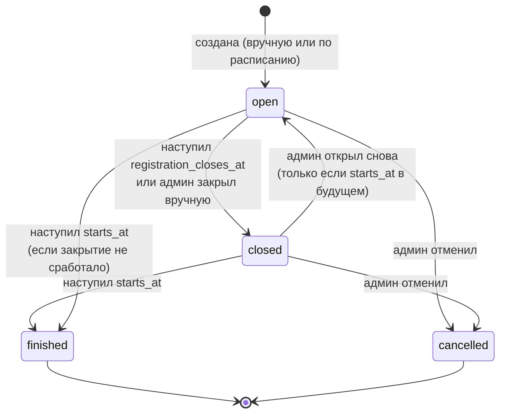
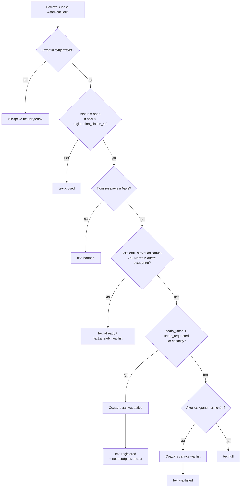

# 5. Бизнес-логика

### 5.1 Жизненный цикл встречи



| Статус | Запись | Отмена участником | Пост |
|---|---|---|---|
| `open` | Да, если есть места | Да, до `cancel_deadline_at` | С кнопками |
| `closed` | Нет | Нет | Без кнопок, пометка «Запись закрыта» |
| `finished` | Нет | Нет | Без кнопок, пометка «Встреча прошла» |
| `cancelled` | Нет | Нет | Без кнопок, пометка «Встреча отменена» |

«Мест нет» — это **не статус**, а вычисляемое состояние: `seats_taken >= capacity` при статусе `open`. Если кто-то отменит запись, место снова станет доступным.

Отметка явки хранится отдельно от статуса: поле `attendance_marked_at`.

### 5.2 Расчёт ключевых моментов времени

Все моменты вычисляются при создании встречи из настроек и сохраняются в самой встрече. Если позже поменять настройки, уже созданные встречи не изменятся. Каждый момент админ может поправить вручную в карточке встречи.

| Поле | Формула по умолчанию | Пример (встреча в субботу, 17:00) |
|---|---|---|
| `starts_at` | день недели и время из настроек | сб, 17:00 |
| `cancel_deadline_at` | `starts_at.date − cancel_deadline_days_before` в `cancel_deadline_time` | пт, 20:00 |
| `registration_closes_at` | `starts_at − registration_close_hours_before` (по умолчанию 0: запись закрывается в момент начала) | сб, 17:00 |
| `reminder_at` | `starts_at − reminder_hours_before` | пт, 17:00 |
| `attendance_prompt_at` | `starts_at + attendance_prompt_hours_after` | сб, 22:00 |

**Инварианты** (проверяются при создании и редактировании):
`created_at < cancel_deadline_at <= registration_closes_at <= starts_at < attendance_prompt_at`.
Если дедлайн отмены получается позже закрытия записи, он приравнивается к закрытию.

**Часовой пояс.** В БД всё хранится в UTC. На экран всё выводится в часовом поясе из настроек (по умолчанию `America/Montevideo`). Вычисления по календарю («суббота, 17:00») делаются в локальном поясе через `zoneinfo`, потом переводятся в UTC.

### 5.3 Алгоритм записи («Записаться»)

Проверки идут строго в этом порядке. Первая сработавшая определяет ответ.



- `seats_requested` = 1, а при записи «+1» = 2.
- Пункты C–G выполняются **атомарно**: под блокировкой встречи (`asyncio.Lock` на `event_id`) и внутри одной транзакции БД (`BEGIN IMMEDIATE`). Это гарантирует, что 11-й не пройдёт даже при одновременных нажатиях (см. 9.3).
- После успешной записи данные пользователя (имя, @username) обновляются в таблице `users`. Если пользователь ни разу не нажимал Start у бота (`dm_available = false`), во всплывающем окне добавляется приглашение включить напоминания (см. 8.4).
- Если включено уведомление админов о заполнении (`notify_admins_on_full`) и это была последняя свободная позиция, бот пишет в служебный чат «Встреча 25.10 заполнена».

### 5.4 Алгоритм отмены («Отменить запись»)

1. Нет активной записи и нет места в листе ожидания → `text.not_registered`.
2. Запись в листе ожидания → удаляется из очереди в любой момент до закрытия записи, без штрафа.
3. `now >= cancel_deadline_at` или статус не `open` → `text.cancel_too_late`.
4. Иначе запись получает `status = cancelled` и `cancelled_at = now`. Если включён лист ожидания, место переходит первому в очереди (5.5). Посты пересобираются, пользователь видит `text.cancelled`, админам уходит уведомление (если `notify_admins_on_cancel`).

После дедлайна отменить запись может только админ из карточки встречи. Он выбирает: «без штрафа» (просто удалить запись) или «как неявка» (запись получает `attendance = no_show`, и это сразу засчитывается в порог бана).

### 5.5 Лист ожидания (выключен по умолчанию, `waitlist_enabled`)

- Если мест нет, человек получает запись `status = waitlist`. Очередь упорядочена по `created_at`.
- Место освобождается при отмене, удалении админом или увеличении лимита. Тогда люди из очереди по порядку переходят в `active`, пока им хватает мест. Человек с «+1», которому не хватает двух мест, **пропускается**, а следующий за ним продвигается.
- Продвинутому участнику бот пишет в личку (если может). В посте он сразу появляется в списке.
- **Защита от несправедливого бана:** если человека продвинули из очереди позже, чем за `late_promotion_hours` (по умолчанию 24) до начала, запись получает `late_promoted = true`. Неявка по такой записи **не засчитывается** в бан, потому что человек мог не узнать о продвижении.
- При закрытии записи очередь просто остаётся в истории со статусом `waitlist`.

### 5.6 Запись с гостем «+1» (выключено по умолчанию, `plus_one_enabled`)

- Под постом появляется кнопка «Записаться +1». Она создаёт запись с `guests = 1` и занимает 2 места.
- Если свободно только одно место, бот показывает `text.only_one_seat` («Осталось одно место — запишитесь без гостя») и ничего не создаёт.
- Отменить можно только всю запись целиком.
- Неявка по записи с гостем считается как одна неявка владельца записи. Гость в системе не учитывается.
- В посте такая запись выглядит как `Александр (+1)`.

### 5.7 Действия админа над встречей

| Действие | Правила |
|---|---|
| Изменить текст, фото, место, ссылку на карту | Все посты встречи пересобираются |
| Изменить дату и время | Пересчитываются все моменты из 5.2. Каждый записавшийся, которому бот может писать, получает уведомление о переносе |
| Изменить лимит | Не ниже `seats_taken`. При увеличении может сработать продвижение из очереди |
| Добавить участника вручную | Выбрать пользователя Telegram (кнопка выбора пользователя, см. 8.6) или ввести имя для человека без Telegram (`manual_name`). Лимит учитывается, но админ может его превысить, подтвердив действие |
| Удалить участника | Запись получает `status = removed`, `removed_by`. Без штрафа |
| Закрыть / открыть запись | Переход `open ↔ closed`. Повторное открытие возможно только если `starts_at` в будущем |
| Отменить встречу | `status = cancelled`, посты получают пометку «Встреча отменена: <причина>». Бот пишет всем активным участникам, которым может писать. Неявки по отменённой встрече не засчитываются |
| Выгрузить список | CSV: имя, @username, ссылка на профиль, статус, гости, время записи, явка |

### 5.8 Явка и бан

**Отметка явки:**

1. В `attendance_prompt_at` бот присылает **каждому** админу сообщение с участниками встречи (`status = active`). У каждой строки есть переключатель ✅/🚫, по умолчанию ✅.
2. Нажатие на строку меняет отметку только в этом сообщении, в БД ничего не пишется.
3. При нажатии «Готово» отметки атомарно записываются в `registrations.attendance`, проставляются `attendance_marked_at` и `attendance_marked_by`, выполняется перерасчёт банов. Сообщения у остальных админов редактируются: «Явку отметил(а) <имя>».
4. Если до `attendance_prompt_at + 14 часов` никто не отметил явку, бот напоминает в служебный чат.
5. Если явку не отметили за 7 дней, встреча закрывается для отметки, и все считаются пришедшими. Никого не баним без явного действия админа.
6. Исправить отметку можно из карточки встречи в течение 7 дней после `starts_at`. Каждое изменение пересчитывает бан для затронутых людей.

**Правило бана:**

```
no_shows(user) = количество записей пользователя, где
                 attendance = no_show
                 И late_promoted = false
                 И встреча не cancelled
                 И attendance_marked_at > last_unban_at(user)   -- после разбана счётчик обнуляется

если ban_after_no_shows > 0 и no_shows(user) >= ban_after_no_shows → бан
```

- По умолчанию `ban_after_no_shows = 1`, то есть бан после первой неявки. Значение `0` полностью отключает автобан.
- Бан создаётся с `reason = "no_show"`, ссылкой на встречу и автором — админом, который отметил явку.
- Если включено `remove_banned_from_future_events` (по умолчанию да), активные записи забаненного на будущие встречи получают `status = removed` и освобождают места.
- Ручной бан: админ выбирает человека из списка участников встречи, из списка всех когда-либо записывавшихся или через кнопку выбора пользователя. Причину можно указать текстом.
- Разбан ставит у бана `active = false`, `unbanned_at`, `unbanned_by`. Счётчик неявок для правила обнуляется, при этом история сохраняется.
- Бан привязан к **Telegram user ID**, а не к имени или username. Обход через новый аккаунт возможен, это осознанное ограничение (см. раздел 19).
- Самому человеку при бане бот ничего не пишет. Он узнает о бане при следующей попытке записаться. Можно включить настройкой `notify_user_on_ban`.

### 5.9 Автосоздание еженедельной встречи

- Настройки: `auto_create_enabled`, `auto_create_days_after` + `auto_create_time` (когда создавать: через сколько дней после встречи и во сколько), `event_weekday` + `event_time` (на какой день и время). Привязка к дню встречи, а не к дню недели, нужна, чтобы при смене `event_weekday` автосоздание не приходилось править отдельно.
- Алгоритм тика: если `auto_create_enabled`, вычисляется ближайшая будущая дата `event_weekday`; момент создания — дата предыдущей встречи (эта дата − 7 дней) плюс `auto_create_days_after` дней, в `auto_create_time` по локальному времени. Если момент уже наступил и для даты ещё нет встречи с `recurrence_key = "weekly:YYYY-MM-DD"`, встреча создаётся.
- Уникальный индекс на `recurrence_key` защищает от дублей.
- Встречу, созданную вручную, автосоздание не учитывает: на ту же субботу можно сделать вторую встречу, но не случайно.
- После создания бот пишет в служебный чат: «Создана встреча на сб, 1 ноября, 17:00. Отредактировать / Разослать».

### 5.10 Пост встречи

Пост собирается из шаблона и автоматического блока:

```
{description}                     ← текст, заданный админом (HTML)

📅 {weekday}, {date}, {time}
📍 {place}                        ← ссылка, если задан location_url

Записались: {taken} из {capacity}
В очереди: {waiting}              ← только если очередь не пуста
1. Света
2. Александр (+1)
...
{status_line}                     ← «Мест нет» / «Запись закрыта» / «Встреча отменена» / пусто
```

- Список имён показывается, если `show_names_in_post = true` (по умолчанию выключено). Иначе в посте только счётчик «Записались: 7 из 10» и, если очередь не пуста, строка «В очереди: N» (без имён).
- Имя — это `first_name` (+ `last_name`, если есть) из Telegram, **обязательно экранированное** (`html.escape`). Ссылки на профили в посте не ставятся, они есть только в админских списках.
- **Ограничение длины:** у поста с фото подпись не длиннее 1024 символов, у поста без фото текст не длиннее 4096. Рендер обязан гарантировать лимит. Если текст не помещается, сначала список имён сокращается до «… и ещё N», затем обрезается описание. При сохранении описания админом бот предупреждает, если оно слишком длинное.
- Кнопки при статусе `open`: `[Записаться]` `[Отменить запись]`, и при включённой функции `[Записаться +1]`. При других статусах клавиатура убирается.
- Повторная сборка поста запускается любым изменением записей или встречи. Обновления группируются (см. 9.4).

### 5.11 Пограничные случаи

| Ситуация | Поведение |
|---|---|
| Пользователь нажал кнопку под старым постом закрытой или прошедшей встречи | `text.closed`. Пост пересобирается и теряет кнопки, если ещё не потерял |
| Пользователь сменил имя после записи | В посте новое имя появится при следующей пересборке |
| Пользователь удалил аккаунт | Запись остаётся, имя показывается как в последний раз |
| Админ удалил пост из чата | Telegram вернёт ошибку при редактировании. Пост помечается `is_dead = true` и больше не обновляется |
| Встреча удалена из БД (не должно происходить) | Встречи никогда не удаляются физически, только отменяются |
| Бот перезапустился во время работы | Все моменты хранятся в БД, тик планировщика доделает пропущенное (см. 11) |
| Админ сам записывается | Обычная запись, права админа ни на что не влияют |
| Человек записался после дедлайна отмены, но до закрытия записи | Разрешено. Во всплывающем окне предупреждение, что отменить запись уже нельзя |
| Две встречи открыты одновременно | Поддерживается: всё привязано к `event_id` |
| Админ теряет права, пока у него открыто меню | Каждое действие перепроверяет права и при их отсутствии отвечает «Нет доступа» |
