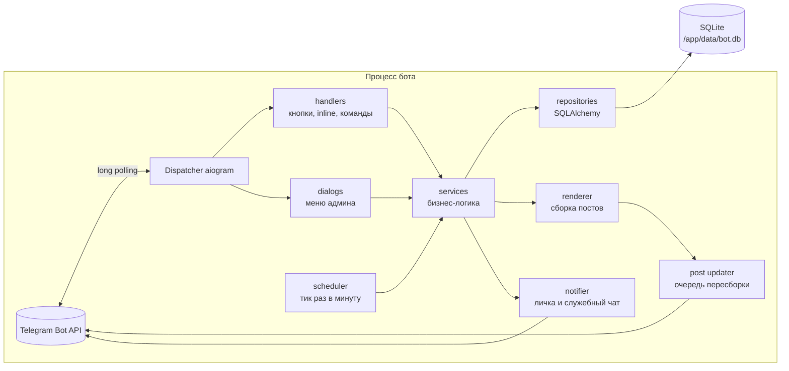

# 9. Архитектура

### 9.1 Обзор

- **Один процесс** на `asyncio`, без брокеров, Redis и воркеров. Для нашей нагрузки этого более чем достаточно, и это сильно упрощает гарантии (9.3).
- Режим получения обновлений: **long polling**. Не нужны домен, HTTPS и открытые порты. Код пишется так, чтобы позже переключение на webhook было вопросом конфигурации (`aiogram` поддерживает оба режима).

### 9.2 Слои и правила зависимостей

| Слой | Знает про Telegram? | Знает про БД? | Ответственность |
|---|:-:|:-:|---|
| `handlers/`, `dialogs/` | да | нет | Разобрать апдейт, проверить права, вызвать сервис, показать результат |
| `services/` | **нет** | через репозитории | Вся бизнес-логика: запись, отмена, лимиты, баны, явка, расчёт времени |
| `repositories/` | нет | да | Запросы к БД |
| `renderer/` | нет (возвращает текст и описание клавиатуры) | нет | Сборка поста из данных |
| `telegram/` (updater, notifier) | да | нет | Отправка и редактирование сообщений, ретраи, лимиты |
| `scheduler/` | нет | через сервисы | Периодические задачи |

Сервисы возвращают **результаты-значения** (например, `RegisterResult.FULL`, `RegisterResult.OK(position=…)`), а не тексты. Тексты подставляет handler. Тогда сервисы легко тестировать без Telegram.

Зависимости (сессия БД, сервисы, настройки) передаются в handlers через middleware и DI aiogram (`data` / workflow data).

### 9.3 Конкурентность и целостность

- **Гонка за последнее место.** Сервис записи берёт `asyncio.Lock` по `event_id` (словарь блокировок в памяти, это работает, потому что процесс один), затем внутри транзакции `BEGIN IMMEDIATE` считает `seats_taken` и вставляет запись.
- Уникальный частичный индекс `(event_id, user_id) WHERE status IN ('active','waitlist')` — вторая линия защиты от двойной записи.
- SQLite: `journal_mode = WAL`, `busy_timeout = 5000`, `foreign_keys = ON`, `synchronous = NORMAL`. Выставляются при каждом подключении через событие `connect`.
- Время берётся из одного источника (`Clock`), который в тестах подменяется.

### 9.4 Пересборка постов (post updater)

1. Любой сервис, изменивший встречу или её записи, вызывает `post_updater.schedule(event_id)`.
2. Updater держит множество «грязных» встреч и для каждой запускает отложенную на 1,5 секунды задачу. Повторные вызовы за это время не создают новых задач (debounce).
3. Задача рендерит пост, считает хеш и для каждого живого `event_posts` с другим хешем вызывает правку. Между правками делаются небольшие паузы, `TelegramRetryAfter` обрабатывается.
4. Если сообщение удалено или недоступно, пост помечается `is_dead`.

5. Вид поста (с фото или без) хранится в `event_posts`. Смена фото у встречи правит фото-посты через `editMessageMedia`; если фото убрали, фото-пост остаётся с прежним фото (Telegram не позволяет превратить его в текстовый), а подпись и счётчик обновляются. Текстовому посту фото не добавляется.

Итог: 10 нажатий за секунду приводят к одной правке каждого поста, а не к десяти.

### 9.4а Побочные эффекты записи

- Ответ на нажатие кнопки не ждёт отправки уведомлений: после коммита «встреча заполнена», сообщения о продвижении из очереди и об отмене уходят фоновыми задачами (`BackgroundTasks` в `services/safe.py`; при остановке бот дожидается их до таймаута).
- Уведомление об отмене записи в служебный чат — не чаще одного раза за 10 минут на пару «человек + встреча», о заполнении — на встречу (`services/cooldown.py`): цикл «записаться — отменить» не заспамит чат и не упрёт бота в лимит Telegram.
- Входящие нажатия и сообщения в личке ограничены по частоте (5 за 2 секунды на человека, `middlewares/rate_limit.py`); лишние нажатия получают «Слишком часто, подождите секунду».
- Реестр блокировок встреч не растёт: блокировка без владельца и ожидающих удаляется.

### 9.5 Обработка ошибок

- Глобальный error handler aiogram логирует исключение, отправляет короткое сообщение в служебный чат (не чаще одного раза в минуту на один и тот же тип ошибки) и, если задан `SENTRY_DSN`, отправляет событие в Sentry.
- Служебный чат: если группа превращена в супергруппу, бот пишет в лог новый идентификатор; если бота удалили или чат не найден, сообщение дублируется владельцам в личку. При старте бот проверяет чат: публичная группа или не группа — предупреждение (в чат уходят копии базы с персональными данными). В режиме `ENV=dev` стартовое сообщение помечено «РЕЖИМ DEV».
- Если напоминание «пост не разослан» не доставлено, отметка снимается и повтор идёт не чаще чем раз в 30 минут.
- Пользователь при внутренней ошибке видит всплывающее окно «Что-то пошло не так, попробуйте ещё раз». Без трейсбеков.
