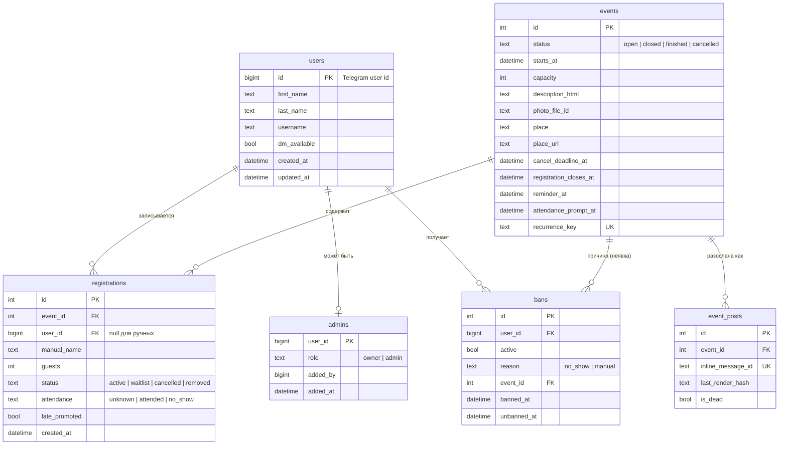

# 10. Модель данных

### 10.1 ER-диаграмма

### 10.2 Таблицы подробно

Время везде в UTC (`DateTime(timezone=True)` + `TypeDecorator`, который гарантирует aware-datetime в UTC при чтении и записи, потому что SQLite сам часовые пояса не хранит).

**`users`**

| Поле | Тип | Примечание |
|---|---|---|
| `id` | BIGINT PK | Telegram user ID (не автоинкремент) |
| `first_name`, `last_name`, `username` | TEXT | Обновляются при каждом взаимодействии |
| `dm_available` | BOOL, default false | См. 8.4 |
| `created_at`, `updated_at` | DATETIME | |

**`admins`**: `user_id` PK FK → users, `role` (`owner`/`admin`), `added_by`, `added_at`. Владельцы из `OWNER_IDS` синхронизируются при старте бота.

**`events`**

| Поле | Тип | Примечание |
|---|---|---|
| `id` | INTEGER PK | |
| `status` | TEXT | `open` / `closed` / `finished` / `cancelled` |
| `starts_at` | DATETIME | |
| `capacity` | INT | |
| `description_html`, `photo_file_id`, `place`, `place_url` | TEXT | |
| `cancel_deadline_at`, `registration_closes_at`, `reminder_at`, `attendance_prompt_at` | DATETIME | Вычисляются при создании (5.2) |
| `reminder_sent_at`, `attendance_prompt_sent_at`, `attendance_reminder_sent_at` | DATETIME NULL | Отметки о выполнении для планировщика |
| `attendance_marked_at`, `attendance_marked_by` | NULL | |
| `closed_at`, `cancelled_at`, `cancel_reason` | NULL | |
| `recurrence_key` | TEXT NULL, UNIQUE | `weekly:2026-10-31` для автосозданных |
| `created_by` | BIGINT NULL | null = создано планировщиком |
| `created_at`, `updated_at` | DATETIME | |

Индексы: `(status, starts_at)`, `(status, registration_closes_at)`.

**`registrations`**

| Поле | Тип | Примечание |
|---|---|---|
| `id` | INTEGER PK | |
| `event_id` | FK → events | |
| `user_id` | FK → users, NULL | NULL для участника, добавленного вручную без Telegram |
| `manual_name` | TEXT NULL | Обязательно, если `user_id` NULL |
| `guests` | INT default 0 | 0 или 1 |
| `status` | TEXT | `active` / `waitlist` / `cancelled` / `removed` |
| `source` | TEXT | `button` / `admin` |
| `attendance` | TEXT default `unknown` | `unknown` / `attended` / `no_show` |
| `late_promoted` | BOOL default false | См. 5.5 |
| `created_at` | DATETIME | Порядок в списке и в очереди |
| `promoted_at`, `cancelled_at`, `removed_at`, `removed_by` | NULL | |

Ограничения:
- `UNIQUE (event_id, user_id) WHERE status IN ('active','waitlist') AND user_id IS NOT NULL` (частичный индекс);
- `CHECK (user_id IS NOT NULL OR manual_name IS NOT NULL)`.

Индекс: `(event_id, status, created_at)`.

`seats_taken(event) = SUM(1 + guests) WHERE event_id = ? AND status = 'active'`.

**`event_posts`**: `id`, `event_id` FK, `inline_message_id` UNIQUE, `posted_by` (user ID админа), `created_at`, `last_render_hash`, `last_edited_at`, `is_dead`. Колонки `chat_id`/`message_id` (NULL) зарезервированы на будущее, для публикации постов от имени бота.

**`bans`**: `id`, `user_id` FK, `active` BOOL, `reason` (`no_show` / `manual`), `comment`, `event_id` NULL FK, `banned_by`, `banned_at`, `unbanned_by`, `unbanned_at`. Частичный уникальный индекс `(user_id) WHERE active`: активный бан у человека максимум один.

**`settings`**: `key` TEXT PK, `value` JSON, `updated_by`, `updated_at`.

**`audit_log`**: `id`, `actor_id` (NULL = система), `action` (например, `event.create`, `registration.create`, `ban.create`, `settings.update`), `event_id` NULL, `target_user_id` NULL, `payload` JSON, `created_at`. Нужен для разбора спорных ситуаций («я записывался!»). Пишется из сервисов.

### 10.3 Миграции

- Alembic с `render_as_batch=True` (SQLite не умеет многие `ALTER TABLE`).
- Миграции применяются автоматически при старте контейнера (`alembic upgrade head`, затем запуск бота).
- Каждая миграция проверяется на копии боевой базы перед мержем, если она меняет существующие таблицы.
