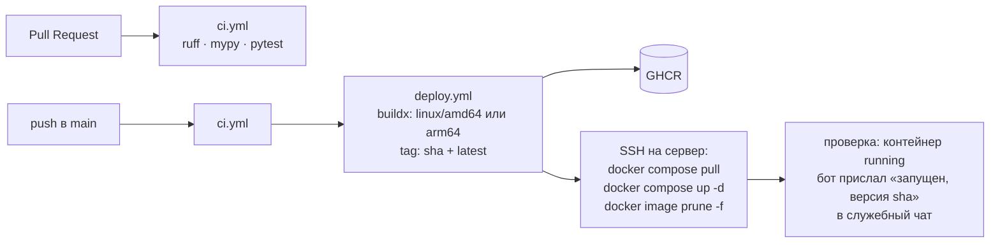

# 17. Деплой и эксплуатация

### 17.1 Хостинг: VPS с Docker

Бот работает на одном небольшом VPS с Docker: Oracle Cloud Always Free или любой сервер за $4–5 в месяц. Образ собирается на сервере из репозитория (17.4).

**Oracle Cloud Always Free:**

- Шейп: **VM.Standard.E2.1.Micro** (AMD, 1 ГБ RAM, x86_64) или **Ampere A1** (ARM, 1 OCPU / 6 ГБ). Боту хватит любого: он занимает около 100–150 МБ.
- ОС: Ubuntu 24.04 LTS. Публичный IPv4 и 10 ТБ исходящего трафика в месяц входят в бесплатный лимит.
- **Риск: Oracle может забрать «простаивающие» Always Free машины** (если 7 дней нагрузка ниже 20%). Бот почти всегда простаивает. По опыту сообщества это решается переводом аккаунта на Pay As You Go: ресурсы в пределах Always Free остаются бесплатными. Официально Oracle этого не гарантирует. Обязательно:
  - настроить бюджет-алерт на $1;
  - держать код и бэкапы так, чтобы переезд на другой сервер занимал меньше часа.
- В 2026 году Oracle без анонса урезал бесплатные лимиты A1. Тарифы могут меняться дальше, нужно следить.
- **Запасной вариант:** Google Cloud e2-micro (около $4 в месяц за публичный IPv4 и диск, если не выбрать Standard) или любой VPS за $4–5 в месяц. Благодаря Docker переезд — это `compose.yaml` + `.env` + файл БД.

### 17.2 Подготовка сервера (один раз)

Пошаговые команды — в [README](../../README.md#4-установка-на-сервер), раздел 4.

1. Создать VM с Ubuntu 24.04 LTS, открыть только SSH (22). Входящие порты боту не нужны: он работает через long polling.
2. Создать пользователя `deploy` с входом по SSH-ключу.
3. Установить Docker Engine и плагин compose из официального репозитория Docker, добавить `deploy` в группу `docker`.
4. Клонировать репозиторий в `/opt/meetup-rsvp-bot/`, создать `.env` из `.env.example` (права 600, `ENV=prod`) и каталог `data/` с владельцем UID 10001 — под этим пользователем бот работает в контейнере.
5. Включить автоматические обновления безопасности (`unattended-upgrades`).

### 17.3 Docker

- Многоэтапный Dockerfile: на этапе `builder` в образе `ghcr.io/astral-sh/uv:python3.14-bookworm-slim` выполняется `uv sync --frozen --no-dev`, на этапе `runtime` в `python:3.14-slim` копируются `.venv`, `src`, `alembic` и `alembic.ini`; процесс запускается под непривилегированным пользователем `bot` (UID 10001).
- Команда запуска — `docker/entrypoint.sh`: задаёт `umask 077` (база и бэкапы содержат персональные данные), проверяет, что каталог `/app/data` доступен для записи пользователю бота (иначе печатает, что выполнить `chown 10001:10001 data`, и завершается с кодом 2), применяет миграции (`alembic upgrade head`) и запускает `python -m meetup_bot`. Миграции применяются при каждом старте контейнера.
- Версия сборки: аргумент `APP_VERSION` (`APP_VERSION=$(git rev-parse --short HEAD) docker compose build`) попадает в переменную окружения образа и в сообщение «Бот запущен».
- Healthcheck — по файлу-пульсу `data/heartbeat` (моложе 180 секунд).
- `compose.yaml`: сервис на локацию, `restart: unless-stopped`, `env_file: .env`, том `./data:/app/data`, `DATABASE_URL` указывает на `/app/data/bot.db`, ограничение логов (`max-size: 10m`, `max-file: 3`), `mem_limit: 300m`. Контейнер работает с минимумом привилегий: `read_only: true` (пишет только в `data/` и `tmpfs /tmp`), `cap_drop: ALL`, `security_opt: no-new-privileges`. Образ можно взять и из GHCR (`ghcr.io/dimbo1324/meetup-rsvp-bot:${IMAGE_TAG:-latest}`) — понадобится после появления `deploy.yml`. В файле есть закомментированный шаблон второй локации (17.8).

### 17.4 Выпуск и CI/CD

**Сейчас (запуск): сборка на сервере.** Образ собирается из репозитория прямо на сервере:

- обновление: `git pull && docker compose up -d --build`;
- если в выпуске есть новая миграция (`alembic/versions/`), перед перезапуском делается ручной бэкап: бот останавливается, `data/bot.db` копируется (17.5);
- откат: `git checkout <предыдущий коммит> && docker compose up -d --build`; если откатываемый выпуск применил миграцию, сначала восстанавливается бэкап, сделанный перед ним (откат схемы `alembic downgrade` не используется).

Команды — в [README](../../README.md), разделы 6–8.

**CI.** `ci.yml` на каждый pull request и push в `main` выполняет `uv run python dev.py quality-gate` (ruff, mypy, pytest, синхронизация правил). Права `GITHUB_TOKEN` — только `contents: read`.

**Позже: автодеплой.** После запуска, по необходимости, добавляется `deploy.yml`; запуск он не блокирует:

Секреты GitHub: `SSH_HOST`, `SSH_USER`, `SSH_PRIVATE_KEY`, `SSH_KNOWN_HOSTS`. Для пуша в GHCR используется встроенный `GITHUB_TOKEN`. **Токена бота в GitHub нет**: он хранится только в `.env` на сервере. Для этого режима на сервере нужен отдельный SSH-ключ деплоя и, если репозиторий приватный, `docker login ghcr.io` с токеном `read:packages`.

**Откат при автодеплое:** в `.env` на сервере задаётся `IMAGE_TAG=<предыдущий sha>`, затем `docker compose up -d`. Если в релизе были миграции БД, перед откатом восстановить бэкап (17.5).

### 17.5 Бэкапы

- Ежедневно в 04:00 бот делает копию БД через SQLite backup API (`sqlite3.Connection.backup`, корректно для работающей базы) в `data/backups/bot-YYYY-MM-DD.db`. Хранятся последние 14 копий.
- Копия проверяется на целостность (`PRAGMA integrity_check`; битая не сохраняется), файлы получают права 0600, каталог — 0700. Если копия за локальную дату уже есть, повторно она не делается; при ошибке повтор не чаще чем через 15 минут.
- Та же копия отправляется документом в служебный чат: это бесплатное хранилище вне сервера, доступное всем админам (файл больше 50 МБ Telegram не принимает: в логе предупреждение). Сбой отправки логируется и не отменяет локальную копию.
- Перед каждым выпуском с миграцией делается отдельный ручной бэкап (бот остановлен, копируется `data/bot.db`).
- Восстановление: остановить бота, отложить `bot.db`, `bot.db-wal`, `bot.db-shm`, положить копию как `bot.db` с владельцем UID 10001, запустить; недостающие миграции применятся при старте. Пошагово — README, раздел 8.
- **Проверка восстановления раз в месяц:** скачать бэкап и запустить с ним бота локально.

### 17.6 Мониторинг

- При старте бот присылает в служебный чат: «Бот запущен, версия `<версия>`» — значение переменной окружения `APP_VERSION`, если она задана (план для `deploy.yml`: sha коммита), иначе версия пакета.
- Ошибки уходят в служебный чат (9.5) и, если задан DSN, в Sentry.
- Healthcheck в Docker: процесс пишет файл-«пульс» на каждом тике планировщика, healthcheck проверяет, что файл моложе 3 минут.
- Если планировщик упал, бот пишет в служебный чат «⚠️ Планировщик остановился: …».
- При запуске бот проверяет служебный чат: публичная группа или не группа — предупреждение (в чат уходят копии базы); недоступный чат — сообщения дублируются владельцам в личку.
- Sentry: если задан `SENTRY_DSN`, из событий вырезаются токены бота и локальные переменные, персональные данные не отправляются.
- Опционально: внешний мониторинг (например, бесплатный heartbeat у UptimeRobot или Healthchecks.io), куда бот раз в 5 минут отправляет HTTP-пинг. Если пингов нет, приходит письмо или сообщение в Telegram.

### 17.7 Безопасность и персональные данные

- Храним минимум: Telegram ID, имя, username, историю записей и банов. Телефоны и другие контакты не собираем.
- Экспорт CSV доступен только админам. Бот не отправляет трейсбеки в чаты: в служебный чат уходит только тип ошибки. Служебный чат — отдельная закрытая группа: владелец, бот и ответственные ведущие; участников сообщества в нём нет. В него приходят ежедневные бэкапы с персональными данными.
- Если пользователь попросит удалить его данные, админ анонимизирует его записи (бэклог: команда в меню). Бан при этом сохраняется по ID: удаление данных не должно снимать бан.
- Нужно учитывать закон Уругвая о защите персональных данных (Ley 18.331). Хранение минимальных данных для организации встреч сообществом выглядит безопасно, но это не юридическая консультация.
- Токен бота при утечке перевыпускается через BotFather (`/revoke`), затем обновляется `.env` и бот перезапускается.
- Доступ к Oracle-аккаунту: у владельца и одного резервного человека, с 2FA.

### 17.8 Несколько локаций

Каждая локация (город, площадка со своим ведущим) — отдельная установка бота: свой бот в @BotFather и свой токен, своя база, свои владельцы, админы, настройки и чёрный список. Код один, локации никак не связаны, поэтому сбой или ошибка настройки одной не затрагивает другие.

На одном сервере это второй сервис в `compose.yaml` (шаблон в файле закомментирован): тот же образ, свой `env_file` (`.env.<локация>`), свой каталог данных `./data-<локация>` и своё имя сервиса. Бэкапы, обновление и откат — общие для всех сервисов файла. Один токен нельзя использовать в двух сервисах: процессы будут перехватывать друг у друга обновления.
