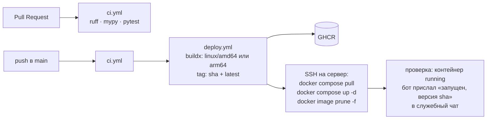

# 17. Деплой и эксплуатация

### 17.1 Хостинг: Oracle Cloud Always Free

- Шейп: **VM.Standard.E2.1.Micro** (AMD, 1 ГБ RAM, x86_64) или **Ampere A1** (ARM, 1 OCPU / 6 ГБ). Боту хватит любого: он занимает около 100–150 МБ.
- ОС: Ubuntu 24.04 LTS. Публичный IPv4 и 10 ТБ исходящего трафика в месяц входят в бесплатный лимит.
- **Риск: Oracle может забрать «простаивающие» Always Free машины** (если 7 дней нагрузка ниже 20%). Бот почти всегда простаивает. По опыту сообщества это решается переводом аккаунта на Pay As You Go: ресурсы в пределах Always Free остаются бесплатными. Официально Oracle этого не гарантирует. Обязательно:
  - настроить бюджет-алерт на $1;
  - держать код и бэкапы так, чтобы переезд на другой сервер занимал меньше часа.
- В 2026 году Oracle без анонса урезал бесплатные лимиты A1. Тарифы могут меняться дальше, нужно следить.
- **Запасной вариант:** Google Cloud e2-micro (около $4 в месяц за публичный IPv4 и диск, если не выбрать Standard) или любой VPS за $4–5 в месяц. Благодаря Docker переезд — это `compose.yaml` + `.env` + файл БД.

### 17.2 Подготовка сервера (один раз)

1. Создать VM, открыть только SSH (22). Входящие порты боту не нужны.
2. Создать пользователя `deploy` и выдать ему SSH-ключ (отдельный ключ для GitHub Actions).
3. Установить Docker Engine и плагин compose, добавить `deploy` в группу `docker`.
4. Создать каталог `/opt/meetup-rsvp-bot/` с `compose.yaml`, `.env` (права 600) и `data/`.
5. Выполнить `docker login ghcr.io` с токеном `read:packages` (если репозиторий приватный).
6. Включить автоматические обновления безопасности (`unattended-upgrades`).

### 17.3 Docker

- Многоэтапный Dockerfile: на этапе `builder` образ `ghcr.io/astral-sh/uv` + `python:3.14-slim` выполняет `uv sync --frozen --no-dev`, на этапе `runtime` в `python:3.14-slim` копируется `.venv` и `src`, процесс запускается под непривилегированным пользователем.
- Entrypoint: `alembic upgrade head && python -m meetup_bot`.
- `compose.yaml`: один сервис, `restart: unless-stopped`, `env_file: .env`, том `./data:/app/data`, ограничение логов (`max-size: 10m`, `max-file: 3`), `mem_limit: 300m`.

### 17.4 CI/CD (GitHub Actions)

Секреты GitHub: `SSH_HOST`, `SSH_USER`, `SSH_PRIVATE_KEY`, `SSH_KNOWN_HOSTS`. Для пуша в GHCR используется встроенный `GITHUB_TOKEN`. **Токена бота в GitHub нет**: он хранится только в `.env` на сервере.

**Откат:** в `.env` на сервере задаётся `IMAGE_TAG=<предыдущий sha>`, затем `docker compose up -d`. Если в релизе были миграции БД, перед откатом восстановить бэкап (17.5).

### 17.5 Бэкапы

- Ежедневно в 04:00 бот делает копию БД через SQLite backup API (`sqlite3.Connection.backup`, корректно для работающей базы) в `data/backups/bot-YYYY-MM-DD.db`. Хранятся последние 14 копий.
- Та же копия отправляется документом в служебный чат: это бесплатное хранилище вне сервера, доступное всем админам.
- Перед каждым деплоем с миграцией делается отдельный бэкап.
- **Проверка восстановления раз в месяц:** скачать бэкап и запустить с ним бота локально.

### 17.6 Мониторинг

- При старте бот присылает в служебный чат: «Бот запущен, версия `<sha>`».
- Ошибки уходят в служебный чат (9.5) и, если задан DSN, в Sentry.
- Healthcheck в Docker: процесс пишет файл-«пульс» на каждом тике планировщика, healthcheck проверяет, что файл моложе 3 минут.
- Опционально: внешний мониторинг (например, бесплатный heartbeat у UptimeRobot или Healthchecks.io), куда бот раз в 5 минут отправляет HTTP-пинг. Если пингов нет, приходит письмо или сообщение в Telegram.

### 17.7 Безопасность и персональные данные

- Храним минимум: Telegram ID, имя, username, историю записей и банов. Телефоны и другие контакты не собираем.
- Экспорт CSV доступен только админам. В служебном чате только админы.
- Если пользователь попросит удалить его данные, админ анонимизирует его записи (бэклог: команда в меню). Бан при этом сохраняется по ID: удаление данных не должно снимать бан.
- Нужно учитывать закон Уругвая о защите персональных данных (Ley 18.331). Хранение минимальных данных для организации встреч сообществом выглядит безопасно, но это не юридическая консультация.
- Токен бота при утечке перевыпускается через BotFather (`/revoke`), затем обновляется `.env` и бот перезапускается.
- Доступ к Oracle-аккаунту: у владельца и одного резервного человека, с 2FA.
