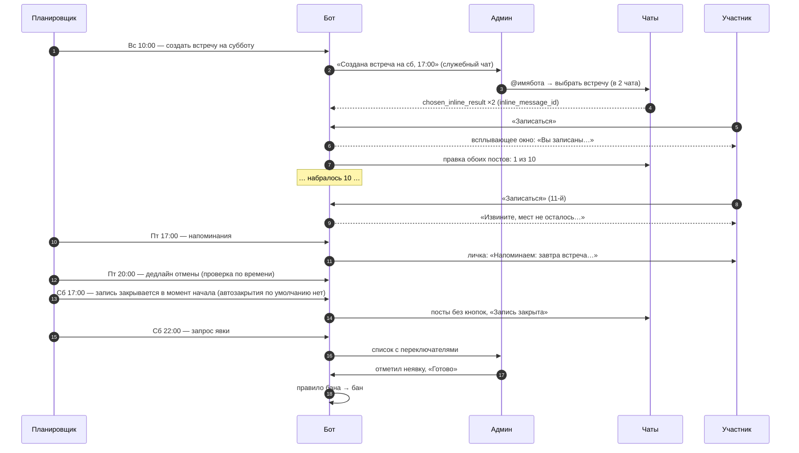

# 21. Приложения

### Приложение А. Настройка бота в BotFather

Выполняется для боевого бота и для каждого тестового.

| Команда | Значение |
|---|---|
| `/newbot` | Имя и username |
| `/setdescription`, `/setabouttext` | «Бот для записи на встречи сообщества» |
| `/setuserpic` | Аватар |
| `/setinline` | Включить, placeholder: «Выберите встречу…» |
| `/setinlinefeedback` | **Enabled** (обязательно, см. 8.1) |
| `/setjoingroups` | Разрешить: бот нужен в служебном чате. После добавления можно запретить |
| `/setprivacy` | Enabled (по умолчанию): в группах боту не нужно читать сообщения |
| `/setcommands` | Не обязательно: команды задаются из кода через `setMyCommands` |

Права на боевого бота: владелец аккаунта в BotFather — один из владельцев проекта. При необходимости бота можно передать другому аккаунту через `/mybots` → Transfer ownership.

### Приложение Б. Пример жизненного цикла недели



### Приложение В. Формат CSV-выгрузки

```csv
event_date,position,name,username,user_id,profile_link,status,guests,registered_at,attendance
2026-10-31,1,Света,sveta_mvd,111111,tg://user?id=111111,active,0,2026-10-26 10:03,attended
2026-10-31,2,Иван Петров (вручную),,,,active,0,2026-10-27 18:20,unknown
```

Кодировка UTF-8 с BOM, чтобы Excel правильно открывал кириллицу. Время в часовом поясе из настроек.
